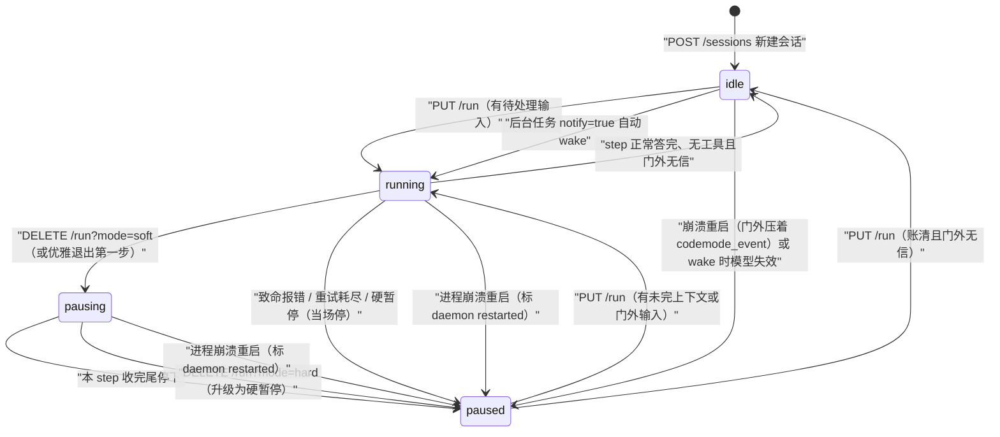

# 01 · 核心抽象与 Agent 循环

很多人刚接触 Agent 框架时，容易把“聊天记录”“发给模型的输入”和“执行工具的过程”混成一团。一遇到并发插话、工具跑到一半断网、或者用户按下暂停再恢复，账目马上就会算乱：要么同一句话被重复执行两遍，要么工具跑了一半没人认领，要么重启后悄悄把有副作用的脚本又跑了一遍。

MyGo-Bot 把整个会话引擎拆得非常干净：**先把账目和排队分开，再把“投信”和“点火”分开，最后靠两个小书签锁住每一步的断点。** 这一篇先把最核心的一套抽象从底往上立起来。

---

## 先选模型、再建会话与点火

在使用之前，先理清配置和会话的上下游关系（详见 [第 3 篇](03-catalog-media-and-billing.md)）：

- **供应商与模型目录（`llm_providers` 与 `llm_models`）**：模型的上游地址 `base_url`、密钥 `api_key`、模型代号 `model_key`、上下文窗口大小、支持的输入模态（`text`、`image`、`audio`、`video`）、推理强度档位以及价格表，都登记在独立的目录表里。
- **全局默认表 `config`**：`config` 表只有一行（`id = 1`），只存两样东西——默认模型 ID（`default_model_id`）和默认推理强度（`default_reasoning_effort`）。它不存提示词，也不直接存 URL 和密钥。
- **会话怎么继承配置**：调 `POST /sessions` 可以先建一个空会话；如果没单独指定模型和推理强度，程序就把 `config` 里**当时**的默认值抄进新建的 `sessions` 行。以后再改全局默认值，只影响**之后新建**的会话；已有会话可以随时通过 `PATCH /sessions/{sid}` 单独调整。
- **什么时候必须有可用模型**：建空会话时 `model_id` 可以暂时是空的；但真想往会话里投信（`POST /sessions/{sid}/messages`）或者点火开工（`PUT /sessions/{sid}/run`），会话必须已经选定一个**可用**（自己和所属供应商都没有被归档）的模型。发给上游时，除了在 `input` 最前面实时拼入一条静态英文 `role: "developer"` 指南消息（位于 [src/model.rs](../src/model.rs#L55-L107)；内含编译期静态写入的宿主 OS/架构，不含动态环境信息、不写进流水账，同时可稳定命中上游前缀缓存）外，会话上下文完全原封不动按 OpenAI Responses API 发出去。

---

## 两本账：流水账 `items` 与上下文 `context_items`

先看它怎么记账。

一个会话里发生的所有事情——你发来一条消息、撤回了一条还在排队的消息、模型吐出一段思考或一句完整回答、发起一次工具调用、拿回一条工具结果、或者后台代码任务发回一条半路报告——**每发生一件，就单独记一笔。这么一笔，就叫一个 `item`。** 所有 `item` 按发生先后顺次插进 `items` 表，这就是会话的**流水账**。

流水账有个铁规矩：**只增不删**（除非整场会话被 `DELETE /sessions/{sid}` 删掉）。连撤回消息都不是去抹掉原记录，而是往流水账里新记一笔 `kind = 'withdrawal'`、拿 `target_id` 指回那条原消息的撤回单。

但流水账绝对不能原封不动直接端给模型看：
1. 你刚才插的一句话还在门外排队，当前这步请求早就发出去了，不能半路插队；
2. 排着队被你撤回的消息，以及撤回单本身，模型压根不该看见；
3. 模型同一回合可能一口气并发派出好几个工具，谁先跑完谁后跑完说不准，工具结果的落账顺序可能是乱的，喂给模型前必须按当初发起调用的顺序重新排齐。

所以程序另外备了一张 `context_items` 表，里面按每个会话各自从 `1` 开始单调递增的 `position` 列指着 `items.id`（主键为 `(session_id, position)`）。这张单子专门记着**模型下一问该读哪几笔、按什么顺序读**——**这份排好序的材料，就叫上下文。**

```
流水账 items（按发生顺序只增不删）          上下文 context_items（按 position 排齐喂模型）
  #1  user_message（老问题）        ───▶    pos 1 -> #1
  #2  assistant_message             ───▶    pos 2 -> #2
  #3  function_call (A)             ───▶    pos 3 -> #3
  #4  function_call (B)                     （等 B 返回后按调用序成对归档）
  #5  function_call_output (B先完)  ───┐
  #6  user_message（排队的插话）            （门外排队，本步不收）
  #7  user_message（误发）                  （被 #8 撤回，永不进上下文）
  #8  withdrawal -> target_id=#7
  #9  function_call_output (A后完)  ───┴─▶  pos 4 -> #4, pos 5 -> #9, pos 6 -> #3?（先 A 后 B：#3->#9, #4->#5）
```

> **类型防伪边界**：流水账里的 `kind` 分为两类——模型产出的项（如 `assistant_message`、`reasoning`、`function_call`、`image_generation_call`）和宿主系统写入的项（`user_message`、`withdrawal`、`function_call_output`、`codemode_event`）。[src/model.rs](../src/model.rs#L452-L468) 在接收模型输出时，会自动把 `type="message"` 且 `role="assistant"` 归档为 `assistant_message`，同时明确拒收任何冒充系统保留类型的输出项，防止上游异常响应污染账本语义。

---

## 投信与点火分离、一趟 `step` 与 `steer`

再看它怎么被推着干活。

**在这个程序里，“投信”和“点火”是分开的。** 会话停着时（`idle` 或 `paused`），客户端调 `POST /sessions/{sid}/messages` 发消息，只是往 `items` 流水账里塞进一条 `user_message`，就像把信投进门外信箱，不会自己去叫模型；真要让模型干活，得调一次 `PUT /sessions/{sid}/run` 点火开工。

不过一旦点火跑起来（进入 `running`），后面就不用再反复点火了——手头这一趟活收完尾，它自己会去翻门外信箱还有没有新信，有就接着跑。

具体一趟活是怎么走的？

1. **收信并开单**：Worker 开跑后，先让记账员在一个事务里把门外排队且没被撤回的新输入收进 `context_items`，在 `llm_calls` 表里开一笔 `in_flight` 调用单并钉死本轮读取的上下文终点 `input_end_position`（见 [第 3 篇](03-catalog-media-and-billing.md)）。
2. **流式问模型**：拿着截至 `input_end_position` 的上下文，连上内置的 6 个工具定义（[src/tools.rs](../src/tools.rs)），向 `{base_url}/responses` 发出 `POST` 请求（`stream: true, store: false`，带可选的 `reasoning.effort`）。
3. **边读流边派工具**：响应以 SSE 流回来，程序一边把片段吐给实时订阅者（见 [第 7 篇](07-realtime-api-and-webui.md)），一边盯着完整的输出项（`response.output_item.done`）。只要凑齐一条 `function_call`，程序立刻先把它记进 `items` 流水账（不马上进 `context_items`），当场异步 `spawn` 出去跑，**不等模型把整段话说完，也不等工具跑完**。如果是文本回答或思考块（`reasoning`），当场就记进 `items` 并顺手收进 `context_items`。
4. **顺手合写小优化**：如果模型这一步没调任何工具，在收到最后一条完整回答（`output_text` 或 `refusal`）的那一瞬间，程序会偷瞄一眼网络缓冲区——要是 `response.completed` 结束信号已经紧跟在后面躺着了，它就不先写一次库再结算一次，而是把“写入 `assistant_message`、结算 `llm_calls` 账单、清零 `needs_model`、把会话切回 `idle`（或暂停）”合进同一次 SQLite 事务提交，白省一趟刷盘。
5. **工具收尾归档**：等这一次模型响应流收尾、派出去的这批工具也全都跑完交卷，记账员按当初发起调用的先后顺序，把每对 `(function_call, function_call_output)` 一起归入 `context_items`。

**从发起这一次模型请求，到这次响应和这批工具全部收尾归档，就叫一个 `step`。**

要注意区分**业务报错**和**系统崩溃**：
- 模型把工具名写错了、参数格式不对，或者脚本代码自己抛错，程序都会把错误原因打包成正常的 `function_call_output` 交回给模型，让它在下一个 `step` 自己看着改；
- 要是某个工具任务的 Rust 执行器本身意外崩溃，或者把结果写进 SQLite 时失败了，会话就直接带着错误原因停进 `paused`。

有了 `item` 和 `step`，整个 Agent 循环和中途插话就水到渠成：
- 这一步只要调过工具（`tools == true`），工具结果刚进上下文，下一步自然要再开一趟 `step` 给模型看结果；
- 要是这一步模型正常交出回答（至少含一条 `output_text` 或 `refusal`）、手头没调工具，而且门外队列里也没有新信，循环才算干完，会话回到 `idle`；如果模型罕见地回了一个既没回答文本也没调任何工具的空完成信号，程序判为异常并报错停进 `paused`；
- 要是这一步刚跑到一半，用户又调接口塞了一句新话进来——新话只是安静记进流水账在门外排着，**已经发出去的这一问不改口**，等当前 `step` 收尾、下一轮开始时它才会被收进上下文。**这种“发出去的不打断、新话从下一问起效”的机制，就是 `steer`。**

---

## 两个书签与 `pending` 视图：断了以后怎么接上？

只要循环允许暂停、允许重开、允许中途插话，记账时如果只存对话记录就一定会漏情况。所以 `sessions` 表里专门留了两个小书签：

1. **`input_queue_cursor`（TypeID 字符串，初值为 `""`）**：**它只管一件事——门外排队的输入（`user_message` 和后台任务投来的 `codemode_event`）已经扫描处理到哪一个 `items.id` 了。** `items.id` 使用 `itm_` 前缀的局部单调 UUIDv7 TypeID，字符串字典序就等价于发生先后；而且 `Db::open` 在启动恢复写入前会先把库里已提交的最大 ID 和 `sessions.input_queue_cursor` 喂给生成器对齐时钟与序号，即便宿主机时钟回拨后重启，新落盘的 `itm_...` 也严格大于历史游标。每次把门外新信收进上下文，或者检查门外发现只剩废单时，游标就向前推进到当前最大的队列条目 ID，绝不回头反复扫描。
2. **`needs_model`（布尔 `0/1`）**：**它只管一件事——已经收进上下文里的材料，还欠不欠模型看一眼。**

很多同学会问：有了上下文，也有了门外游标，为什么非得再留一个 `needs_model` 书签，省掉它会漏掉什么？

看一个最棘手的断流场景就明白了：模型刚流式吐完一句完整的回答，程序已经把这条 `assistant_message` 记进 `items` 并收进 `context_items` 了；可紧接着后面模型本来还打算调个工具，还没来得及吐出来，上游连接断了（或者被用户一记硬暂停掐断了），整趟响应**没收到 `response.completed`**。这时候你去翻账本：门外队列是空的，上下文最后一条也正正好好是一句助手回答！如果省掉 `needs_model`，程序根本分不清“这轮已经正常答完收工了”还是“这句话虽说完了，可这一步其实没走完”。留着 `needs_model = 1`，下次点 `/run` 才知道“欠模型这最后一眼还没还上”，必须接着往后跑。

反过来，当一个 `step` 正常收完尾、且没调工具时，`needs_model` 清零为 `0`。之后会话停着时门外再投进新信，投信本身不动 `needs_model`（依然是 `0`）；等下次调 `PUT /run` 点火，程序调 `take_pending` 把新信收进上下文并推走 `input_queue_cursor` 时，才顺手把 `needs_model` 置回 `1`。

至于门外到底还有哪些“有效待收的信”，全库统一认一张 SQLite 视图 **`pending`**（[schema.sql](../schema.sql#L142-L147)）：
- 它只看 `id > sessions.input_queue_cursor` 的门外条目；
- 如果是 `user_message`，必须没有被 `withdrawal` 撤回；
- 如果是 `codemode_event`，必须带有 `notify = true` 且没被记进 `invalidated_warnings` 作废表（见 [第 5 篇](05-codemode-lifecycle.md)）。

如果门外 `id > input_queue_cursor` 全是撤回消息或作废提醒，`pending` 查出来是空的，负责检查的函数（`has_pending` / `pending_reason`）就会顺手把 `input_queue_cursor` 推过这批废单，免得后面每次开轮都要重扫一遍。

---

## 会话状态机与软暂停 / 硬暂停

`sessions.status` 只有四个合法值：`idle`、`running`、`pausing`、`paused`。配合前面的积木，“暂停”这件事就只剩一个问题：**手头正在跑的这个 `step`，还让不让它做完？**



每个活动会话在内存里都挂着一对取消令牌 `Control { soft, hard }`：

- **软暂停（`DELETE /sessions/{sid}/run` 或 `?mode=soft`）**：只拉响 `soft` 令牌，把数据库状态改成 `pausing`。正在跑的这趟模型流和已经派出去的工具照常跑完、结果照常归档；只等这个 `step` 收完尾，循环看见 `soft` 已取消，就不再开下一步，把会话落成 `paused`（注意：如果是连发两次软暂停，因为 `soft` 已经拉响，不会重复发通知，意思依然是“做完这步就停”）。如果会话本来就没在跑，软暂停也会直接落成 `paused`。
- **硬暂停（`DELETE /sessions/{sid}/run?mode=hard`）**：同时拉响 `soft` 和 `hard`（并顺手把该会话名下所有 `codemode` 任务按 `killed` 拉闸，见 [第 5 篇](05-codemode-lifecycle.md)）。模型请求流被 `tokio::select!` 当场掐断，正在跑的工具和等待器立刻松手。**硬暂停认的保存边界是 `item` 而不是 `step`**：
  - 流到一半还没凑齐的文本、思考碎片或半截工具参数，直接清草稿丢掉；
  - 已经拼完整并落库的 `item` 全都留着；
  - 已经派出去的工具就算正在收尾，先等正在退出的工具任务收净，刚好赶上写库的结果也保留；
  - 那些有 `function_call` 却没拿到 `function_call_output` 的调用，由 `store::publish_tools(..., recovering=true)` 按调用顺序成对归入上下文，并当场补上一句冰冷但诚实的工具结果：**`"Execution interrupted; result unknown."`**。

还有一个很贴心的细节：如果会话先前因为报错停在 `paused`，但账面其实已经平了（`needs_model = 0` 且门外没新信，比如后来你把门外错发的信撤回了），这时调一次 `PUT /sessions/{sid}/run`，程序发现没活可干，会直接帮你把 `last_error` 清空、状态归回 `idle`。如果会话停在 `pausing`，调 `/run` 会直接返回 `409 Conflict`（`"session is pausing"`），让你等这步收完再开。

---

## 由软/硬暂停推出来的三件事

把“软暂停”“硬暂停”和“两个书签”攥在手里，另外三件最容易写乱的机制全能顺着推出来：

### 1. 自动重试（`src/agent.rs` + `src/model.rs`）

上游大模型断流或限流很常见，MyGo-Bot 把上游失败切分成**瞬时错误（`Transient`）**和**致命错误（`Fatal`）**：

| 错误归类 | 具体触发情况 | 处理策略 |
| :--- | :--- | :--- |
| **瞬时错误** | 30 秒没连上或没收到响应头、HTTP `408` / `429` / `5xx`、流式读取连续 **60 秒**没有任何新行（SSE 心跳注释 `:` 会续命）、半路意外断流（EOF）、只看到 `[DONE]` 却缺 `response.completed` | 等待本步已派工具先跑完并把结果归进上下文；向 SSE 推送一条临时的 `attempt.retry` 事件；指数退避 **`250ms` -> `500ms` -> `1000ms`** 后自动开下一轮重试（退避期间若收到软暂停立刻停） |
| **致命错误** | 非 `408`/`429` 的 4xx（如鉴权 401/403、参数错 400）、响应头不是 `text/event-stream`、单条 SSE 帧超过 **16 MiB**、JSON 解析失败、上游显式回 `response.failed` / `response.incomplete` / `error` | 不重试，立即报错把会话停进 `paused` |

自动重试**有点像软暂停**：已派出去的工具照样干完写进库、归进上下文，只是收尾后不是停进 `paused`，而是保持 `running` 带着这批新结果接着问模型。**最多重试 3 次**（加上初次请求总共 **4 次**尝试），只要中间成功了就把重试计数清零；连续失败到第 4 次还没过，就会报 `"retry limit reached: ..."` 停进 `paused`。

### 2. 优雅退出（`src/agent.rs:185-219` + `src/main.rs:543-550`）

进程收到 `SIGINT` 或 `SIGTERM`（Windows 为 Ctrl-C）时，走的是**两步连招**：
1. 先把记账员的 `closing` 标志设为 `true`（从此拒绝新点火，返回 `503`），立刻停掉所有后台 `codemode` 任务，并给全部活动会话发**软暂停**（理由写 `"daemon shutting down"`），最多等 **5 秒**让各 `step` 体面收尾；
2. 5 秒后如果还有会话或前台脚本没退完，立刻切第二步：把剩下的所有任务和会话全部按**硬暂停**掐断，再等最多 **5 秒**让工作协程把进程组和工具账结清；
3. 最后关闭全部 MCP 连接；外层 HTTP 服务器还有 **6 秒**宽限排空在途请求，Tokio 运行时离开前再兜底等 **1 秒**（专门防挂在无响应网络磁盘上的阻塞文件读写拖死进程退出）。

### 3. 崩溃恢复与 Schema 守门（`src/store.rs:71-102` + `src/codemode/ledger.rs:266-304`）

**崩溃恢复专门拿来跟硬暂停做对照：硬暂停是程序还醒着，能自己把残局结清；`SIGKILL` 强杀或直接断电，是连最后一次结账的机会都没给。**

所以进程重新拉起、打开数据库 `Db::open` 时，只认 SQLite WAL 最后一次提交的事务，在一个启动事务里做三件事：
1. **验库并对齐时钟水位**：如果库不是空库，会先校验 `PRAGMA user_version` 是否等于当前版本 `2`，紧接着在任何恢复写入之前调用 `id::seed_from_db`（[src/store.rs](../src/store.rs#L83-L98)）将 ID 生成器推进到库里已提交的最大 ID 与 `input_queue_cursor` 之上，防止时钟回拨重启导致新 ID 倒退；因为尚处早期开发，不写兼容性迁移脚本，一旦发现是旧版不兼容库，直接拒绝启动并报错提示换新目录建库。
2. **截停状态**：把所有还挂着 `'in_flight'` 的 `llm_calls` 标成 `'interrupted'`（`"daemon restarted"`），把所有原先是 `'running'` 或 `'pausing'` 的会话统一标成 `'paused'`，同时交给 `codemode::ledger::recover` 处理未结清的后台任务与过期租期提醒（详见 [第 5 篇](05-codemode-lifecycle.md)）。
3. **等人工重开才补未果工具**：注意启动恢复时**绝不会擅自重跑上次没回来的普通工具调用**——因为账上没记 `function_call_output`，只说明**结果没落盘**，推不出**工具当时没执行过**（比如发邮件、扣款）。重启后这些工具的空缺先留着，等你下次手动调 `PUT /sessions/{sid}/run` 恢复会话时，程序再翻流水账收残局，调用 `publish_tools(..., recovering=true)` 补上 `"Execution interrupted; result unknown."`。补齐残局后要不要接着问模型，又稳稳地回到前面那两个书签：先看 `needs_model`，再看 `pending` 队列，有活接着跑，没活切回 `idle`。

---

**返回目录**：[总览](README.md) · **下一篇**：[02 · 底层底座：单记账员、合批落盘、流式读写与防重](02-storage-and-concurrency.md)
