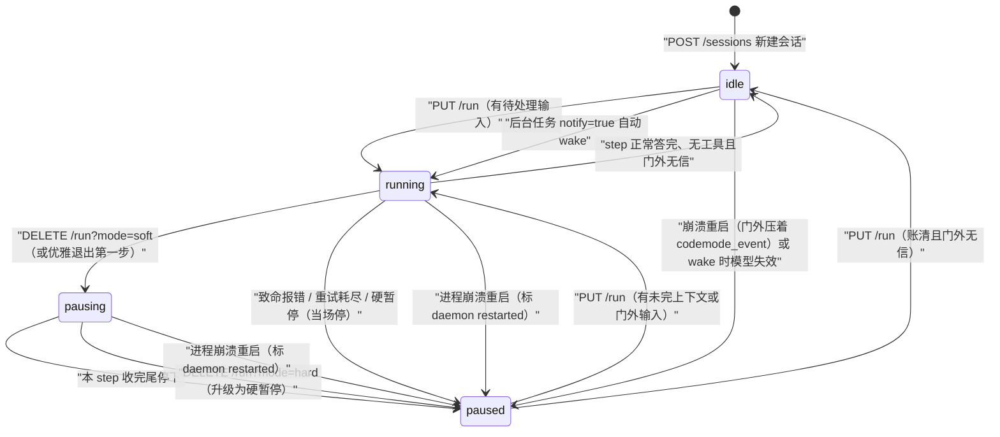

# 01 · 核心抽象与 Agent 循环

很多人刚接触 Agent 框架时，容易把“聊天记录”“发给模型的输入”和“执行工具的过程”混成一团。一遇到并发插话、工具跑到一半断网、或者按下暂停再恢复，账目立刻算乱：同一句话跑两遍、工具结果没人认领，甚至重启后悄悄重放有副作用的操作。

MyGo-Bot 把会话引擎拆得非常干净：**先把账目和排队分开，再把“投信”和“点火”分开，最后用带父指针的上下文树、门外信箱和回合结账集锁住每一步断点。** 这一篇先把单机核心循环从底往上立起来。

---

## 先选模型、再建会话

在聊对话循环前，先理清上游配置（详见 [第 3 篇](03-catalog-media-and-billing.md)）：

- **供应商与模型目录**：`llm_providers` 存上游地址和密钥，`llm_models` 存模型代号、上下文窗口、模态、推理档位和价目表。
- **不再有全局默认 `config` 表**：建会话时 `POST /sessions` **必须显式传入**一个未归档的 `model_id`（缺省或传 `null` 直接 `400`），省掉多节点同步全局配置的包袱；WebUI 会在浏览器记住上次使用的模型，已有会话可随时用 `PATCH /sessions/{sid}` 换模型。
- **静态开发指令前缀**：发请求给模型时，程序会在输入最前面实时拼入一条静态英文 `role: "developer"` 指南（位于 [src/model.rs](../src/model.rs) 并通过 `OnceLock` 缓存前缀，不写入流水账），引导模型用 `cluster.nodes()` / `cluster.node(target)` 发现并调用任意集群节点能力，跨节点也能稳定命中上游 Prompt Cache。

---

## 两本账：流水账 `items` 与上下文 DAG

先看它怎么记账。一个会话里发生的所有事——发消息、撤回消息、模型思考或回答、发起工具调用、工具交卷、后台任务报信——**每发生一件就单独记一笔，这么一笔叫一个 `item`**，带着来源标记 `(origin_node_id, origin_seq)` 插进 `items` 表。

流水账只有一条铁律：**只增不删**（除非整场会话被 `DELETE /sessions/{sid}` 永久墓碑化）。连“撤回消息”都不是删原行，而是往流水账里新记一条 `kind = 'withdrawal'`、拿 `target_id` 指回原消息的撤回单。

但流水账不能直接端给模型看：
1. 你中途插的新话还在门外排着，不能塞进已经飞出去的那一问；
2. 排着队被撤回的消息和撤回单本身，模型不该看见；
3. 模型同一回合常并行派出一串工具，谁先完谁后完不确定，喂给模型前必须按**当初发起调用的先后顺序**重新排齐。

那排齐后的上下文怎么存，才能在多台机器同时离线跑时不撞碎？答案像极了 **Git 提交树**：

1. **只增上下文 DAG（`context_nodes`）**：真正进上下文的每条记录落成一个节点（主键 `ctx_<26位后缀>`），记下 `item_id`、深度 `depth` 和指向前一条的父指针 **`parent_id`**（`NULL` 表示从根起步）。平时它是一条直线；就算两台机器断网在同一点强行分头开跑，也只是在共同祖先下面长出两条平行分支，**谁也不用擦掉谁的历史**。
2. **当前视角与投影（`active_head` -> `active_context`）**：会话行的 `active_head` 指着某颗分支叶节点，[src/cluster/ledger.rs](../src/cluster/ledger.rs) 里的 `reconcile_active_context` 顺着 `parent_id` 回溯展开写进派生表 `active_context`（日常追尾只做增量追加，换分支才全线重排）——这才是直接喂给模型的材料。
3. **安全切分支（`session_leaves`）**：所有分支叶节点记在 `session_leaves` 并随 `Session.branches` 返回。会话非运行时可调 `PATCH /sessions/{sid} { "active_head": "ctx_..." }` 切换分支，服务端严格校验目标必须是 `session_leaves` 里的叶节点（禁止插进半截中间节点造成同枝二次分叉），切完后推进视图版本号 `view_rev` 并广播 `session.reset`。

```
流水账 items（按发生顺序只增不删）        context_nodes (DAG)              active_context（投影喂模型）
  #1  user_message（老问题）        ───▶  ctx_1 (parent=NULL)     ───▶   pos 1 -> #1
  #2  assistant_message             ───▶  ctx_2 (parent=ctx_1)    ───▶   pos 2 -> #2
  #3  function_call (A)                   （等整批工具返回后按调用序成对归档）
  #4  function_call (B)
  #5  function_call_output (B先完)  ───┐
  #6  user_message（排队的插话）          （门外 pending_inputs 排队，本步不收）
  #7  user_message（误发）                （被 #8 撤回，移出 pending_inputs，永不进上下文）
  #8  withdrawal -> target_id=#7
  #9  function_call_output (A后完)  ───┴─▶ ctx_3(#3)->ctx_4(#9)->ctx_5(#4)->ctx_6(#5)  ──▶ pos 3..6（先A后B）
                                                   ▲ active_head
```

> **防伪边界**：流水账里的类型分成模型产出和宿主系统写入两类。[src/model.rs](../src/model.rs) 接收上游输出时会自动把 assistant 文本归为 `assistant_message`，同时严格拒收任何冒充 `user_message`、`withdrawal`、`function_call_output`、`codemode_event` 的输出项。

---

## 投信与点火分离、一趟 `step` 与 `steer`

**在 MyGo-Bot 里，“投信”和“点火”是两件事。** 会话停在 `idle` 或 `paused` 时，调 `POST /sessions/{sid}/messages` 只是把信投进门外信箱（`items` + `pending_inputs`）；必须再调一次 `PUT /sessions/{sid}/run` 才真正点火开工。

多节点下怎么决定谁来跑、怎么防撞车？规则可以压成三句话（完整抢牌协议、Paxos 选民变更与重连对账专章见 [第 8 篇](08-cluster-sync-and-execution.md)）：
- **纯单机（`known_peer_count == 0`）**：零锁零 RPC，直接以 `Standalone` 模式开跑。
- **多节点集群**：开跑前可选 `{ "node": "..." }` 指定由哪台在线节点执行；执行机必须先走 [src/cluster/exec.rs](../src/cluster/exec.rs) 的 `acquire_session_lease` 强同步账本与附件、探测全群占有与进度栅栏、并向 `Voter` 多数派领一块 10 秒可续租的 `Quorum` 工作牌（凑不够多数派默认返 `503`，仅显式传 `force_offline: true` 允许无租约离线强跑）。
- **控制指令自动找人**：只要会话正被远端 Runner 占着，发信、撤回、改标题、暂停、查停任务会自动单跳转发给那台 Runner 处理；删会话也共用同一套 `Voter` 多数派门控（`acquire_delete_gate`）。

一旦点火成功（本机进入 `running`），Worker 会一轮接一轮跑下去，直到活干完为止。每一趟的具体动作如下：

1. **收信并开单**：Worker 通过 `write_for_run` 组提交事务把门外有效的排队消息接上 `active_head`，并在 `llm_calls` 经 [src/calls.rs](../src/calls.rs) 开出一张 `in_flight` 调用单，同时**钉死本轮的上下文终点与分支头 `input_head`**（若运行中途远端同步切走了分支，[src/cluster/sync.rs](../src/cluster/sync.rs) 里的 `abort_active_session_worker` 会立刻拦停旧 Worker）。
2. **流式问模型**：拿着截至 `input_end_position` 的 `active_context` 和 6 个内置 `codemode*` 工具定义，向 `{base_url}/responses` 发流式请求（`stream: true, store: false`）。
3. **边读流边派工具**：响应 SSE 飞回来时，一边推实时打字机流，一边盯着完整输出项——一旦收齐 `function_call`，不等整段话说完、也不等别的工具完，立刻写入流水账并异步 `spawn` 出去跑。
4. **无工具顺手合写优化**：如果这一轮没派任何工具，收到最后一条回答时若缓冲里已经躺着 `response.completed`，就把写回复、登记 `turn_settled`、结清 `llm_calls` 账单和切回 `idle`（或暂停）合并进同一次 SQLite 提交，白省一趟刷盘。
5. **工具收尾归档**：模型流和本批所有工具都交卷后，记账员严格按发起调用时的顺序，把 `(function_call, function_call_output)` 成对追加进 `context_nodes` 与 `active_context`。

**从发出这一次模型请求，到这次响应流和这批工具全部归档，就叫一个 `step`。**

注意区分两种错误归属：模型把工具名写错、参数不对或脚本自己抛错，都会被包装成正常的 `function_call_output` 交回给模型在下一步自己改；唯有执行器本身崩溃或写库失败，会话才会报错停进 `paused`。

顺着 `step`，整套循环规则不言自明：
- 本步只要调过工具，下一步自动继续问模型看工具结果；
- 本步模型正常交出回答、没调工具且门外没有新信，会话回到 `idle`；若模型罕见地吐出既无回答又无工具的空完成信号，直接报错停进 `paused`；
- **`steer`（中途插话）**：本步刚跑到一半又投进新消息，新话只安静排在门外，**不打断已经发出去的那一问**，等本步收完尾、下一步开头才收进上下文。

---

## 告别可变书签：`pending_inputs` 与 `turn_settled`

早期单机靠“门外游标”和“是否欠模型布尔列”两个可改书签追踪断点；放到并发与分布式环境下，可改书签极易覆盖漏账。MyGo-Bot 改用两张防覆盖集合从底层推导状态：

1. **门外信箱 `pending_inputs`（与 `pending` 视图，[schema.sql](../schema.sql)）**：
   - **它只管一件事**：此刻门外还躺着哪些既没撤回、没作废、也没进过 `context_nodes` 的有效输入（`user_message` 和 `notify = true` 的 `codemode_event`）。
   - **省掉它用单调游标会漏什么？** 离线时节点 A 10:01 写一封、B 10:02 写一封；B 的包先到并把游标推到 10:02，迟到的 A 消息（10:01）就会被游标跳过永远卡死在门外。改成事件驱动维护的物化集合后，乱序到达也绝不漏收。
2. **只增回合结账集 `turn_settled`（[src/store.rs](../src/store.rs) `needs_model`）**：
   - **它只管一件事**：把“已经稳稳等来 `response.completed` 且没调工具的回合终点节点 `ctx_...`”记进只增不减的集合。
   - **怎么知道欠不欠模型看一眼？** `needs_model` 不存数据库，而是现场一句算出来：**只要 `active_head` 非空且不在 `turn_settled` 里，就是 `true`。**
   - **省掉它直接看“最后一条是不是助手回答”会漏什么？** 想象模型刚流式答完一句话并落了 `assistant_message`，紧接着还没吐出后面的工具调用就断网了。此时门外队列空着、分支末端也正好是助手回答，但这一步其实没有拿到 `response.completed`。正因为这颗节点不在 `turn_settled` 里，重开时程序一眼就知道还欠模型最后一次收尾检查。

---

## 会话状态机、双轨状态与软/硬暂停

为了既全集群同步“静止态”，又不让某台机器跑到一半或断网熔断的现场污染同伴，数据库把会话状态显式拆成**两组列**：

- **共享持久态（`sessions.status` + `last_error` + `status_ts`）**：只存 `'idle'` 或 `'paused'` 两个稳态，带 HLC 时间戳全群同步；
- **仅本机叠加态（`sessions.local_status` + `local_error`）**：可为 `NULL`、`'running'`、`'pausing'` 或 `'paused'`，**永远不上网**。

读取会话视图时 SQL 优先叠上本机状态：正常停稳写回共享 `idle`/`paused` 时把 `local_status` 清回 `NULL`；而断网失租熔断（[src/agent.rs](../src/agent.rs) `fence_session_local`）或重连软停离线任务时只允许写 `local_status`，绝不污染其他节点已经跑出的新状态。非执行节点则把内存占有表 `PresenceState` 实时叠到 `runner_node_id` 上。



配合上面的状态机，活动会话在内存里挂着控制句柄 `Control { soft, hard, run_gen, lease, forced_offline }`（其中 `run_gen` 每次拉起 Worker 递增，挡住慢一拍的旧输出越界写库；而整支历史切分支或删会话另由 `session_reset_gen` 驱逐旧后台任务）。“暂停”只看一个问题：**当前这一步 `step` 还让不让做完？**

- **软暂停（`DELETE /sessions/{sid}/run` 或 `?mode=soft`）**：先把本机叠加态落为 `local_status = 'pausing'`（写库失败就回滚，绝不半途误取消），再拉响 `soft`。模型流和已派工具照常收完尾，到这一步结束看见 `soft` 已取消才停进 `paused`（重复点软暂停幂等跳过，会话原本静止时直接落成持久 `paused`）。
- **硬暂停（`?mode=hard`）**：同时拉响 `soft`、`hard` 并立刻按 `killed` 拉闸本会话所有后台 `codemode` 任务（见 [第 5 篇](05-codemode-lifecycle.md)）。模型流被当场掐断，边界认 **`item` 而不是 `step`**：
  - 未拼完整的半截流碎片直接丢弃，已完整落库的 `item` 全部保留；
  - 已派出去正在退出的工具等收完，赶上落盘的结果留着；
  - 已经记了 `function_call` 却没拿回结果的调用，由 `publish_tools(..., recovering=true)` 按调用顺序归进上下文，并诚实补上一句 **`"Execution interrupted; result unknown."`**。

在集群里，只要手里还握着有效 `Quorum` 租约，停稳后会写回共享 `status` 并清掉 `local_status`，等所有后台收尾完再放牌；如果写库前已经失租或被 `fence_session_local` 熔断，就只记本机 `local_status = 'paused'`。另有一个小细节：会话停在 `paused` 时若后来把门外错信撤回导致账已平，点一次 `/run` 会自动帮你清掉 `last_error` 归回 `idle`；停在 `pausing` 时再点 `/run` 会直接返 `409 Conflict`。

---

## 由软/硬暂停推出来的三件事

### 1. 自动重试（`src/agent.rs` + `src/model.rs`）

- **瞬时错误（自动重试）**：30 秒建连/首响超时、`408`/`429`/`5xx`、流静默 60 秒（心跳注释可续命）、半路 EOF、只收到 `[DONE]` 却缺 `response.completed`。等本步已派工具跑完归档后，推送一条 `attempt.retry`，按 **`250ms` -> `500ms` -> `1000ms`** 退避重试 **最多 3 次**（退避期收到软暂停立刻停；中间只要成功一次计数清零；第 4 次仍败报 `"retry limit reached: ..."` 停进 `paused`）。
- **致命错误（不重试）**：非 `408`/`429` 的 4xx、非 `text/event-stream`、单帧超 16 MiB、JSON 解析失败、或上游显式回 `response.failed`/`incomplete`/`error`，直接停进 `paused`。

### 2. 优雅退出（[src/agent.rs](../src/agent.rs) + [src/main.rs](../src/main.rs)）

收到 `SIGINT`/`SIGTERM` 时走两步连招：
1. 先把记账员 `closing` 置为 `true`（拒接新点火返 `503`），停掉所有后台 `codemode` 任务，给全部活动会话发软暂停并等最多 **5 秒**收尾；
2. 超时还没退完就把剩余任务和会话全部切硬暂停掐断再等 **5 秒**，最后关光 MCP 与 `iroh` QUIC 连接（外层 HTTP 还有 6 秒排空宽限，退出前另等 1 秒兜底）。

### 3. 崩溃恢复与 Schema `v1` 守门（[src/store.rs](../src/store.rs)）

硬暂停还来得及自己结账，`SIGKILL` 或断电则根本没给机会。进程重启打开 `Db::open` 时，只信 WAL 最后一笔已提交事务，在一个启动事务里做三件事：
1. **验库与对齐单调水位**：核对 `PRAGMA user_version == 1`（Schema `v1` 不写迁移脚本，不匹配直接报错拒绝启动）；接着对齐 `id::seed_from_db`、带 `MAX_HLC_WALL_MS` 守卫的 [`seed_hlc_from_db`](../src/cluster/ledger.rs) 和持久化在 `local_node.catalog_rev` 里的目录水位（[`next_catalog_rev`](../src/cluster/ledger.rs)），加载身份、`voter_epoch`/`voter_set`、同伴与 `session_leases`。
2. **原地按来源恢复本机残局**：只按 `origin_node_id == local_node_id` 过滤，把本机仍挂着 `'in_flight'` 的 `llm_calls` 标成 `'interrupted'`（`"daemon restarted"`）；把停在 `local_status IN ('running', 'pausing')` 的会话收成持久 `'paused'` 并清掉叠加态；并就地跑一遍 `codemode::ledger::recover` 处理本机中断任务与作废提醒。绝不误伤群里别的机器还在跑的会话。
3. **等人工重开才按 `input_head` 补工具残局**：重启时**绝不自动重跑未回结果的普通工具**（因为没落盘结果不等于没执行过副作用）。空缺先留着，等你下次手动点 `/run` 时，由 [`publish_tools`](../src/store.rs) 严格核对 `llm_calls.input_head` 分支归属后只补齐属于当前分支的未果调用（`"Execution interrupted; result unknown."`——绝不把另一条分叉上死掉的工具错拉过来），然后再查 `needs_model` 与 `pending_inputs` 决定接着跑还是回 `idle`。

---

**返回目录**：[总览](README.md) · **下一篇**：[02 · 底层底座：单记账员、合批落盘、流式读写与防重](02-storage-and-concurrency.md)
