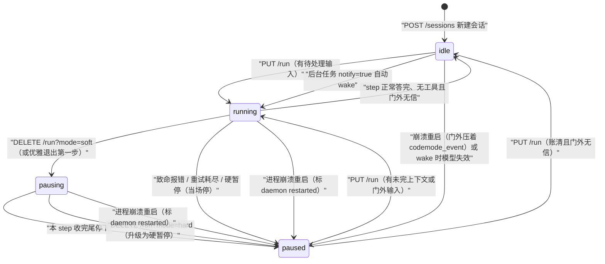

# 01 · 核心抽象与 Agent 循环

很多人刚接触 Agent 框架时，容易把“聊天记录”“发给模型的输入”和“执行工具的过程”混成一团。一遇到并发插话、工具跑到一半断网、或者用户按下暂停再恢复，账目马上就会算乱：要么同一句话被重复执行两遍，要么工具跑了一半没人认领，要么重启后悄悄把有副作用的脚本又跑了一遍。

MyGo-Bot 把整个会话引擎拆得非常干净：**先把账目和排队分开，再把“投信”和“点火”分开，最后用带父指针的上下文 DAG、门外待处理集合和只增回合结账集锁住每一步的断点。** 这一篇先把最核心的一套抽象从底往上立起来。

---

## 先选模型、再建会话与点火

在使用之前，先理清配置和会话的上下游关系（详见 [第 3 篇](03-catalog-media-and-billing.md)）：

- **供应商与模型目录（`llm_providers` 与 `llm_models`）**：模型的上游地址 `base_url`、密钥 `api_key`、模型代号 `model_key`、上下文窗口大小、支持的输入模态（`text`、`image`、`audio`、`video`）、推理强度档位以及价格表，都登记在独立的目录表里。
- **不再维护全局默认表 `config`**：为了免去多节点同步全局配置的耦合与状态同步包袱，系统直接移除全局 `config` 表，改为在建会话时显式选模：数据库里 `sessions.model_id` 是 `NOT NULL`，调 `POST /sessions` **必须传入**一个当前可用（自己和所属供应商都没有被归档）的 `model_id`（缺省或传 `null` 直接返 `400`），可选再带上该模型支持的 `reasoning_effort`；WebUI 会在浏览器 `localStorage` 里记住上次使用的模型并自动回落到首个可用模型（若尚无可用模型则弹窗引导先添加），已有会话随时可以通过 `PATCH /sessions/{sid}` 改换别的有效模型，但不允许把 `model_id` 改回 `null`。
- **发给上游的静态前缀**：会话跑起来发请求时，除了在 `input` 最前面实时拼入一条**云原生跨平台静态英文 `role: "developer"` 指南消息**（位于 [src/model.rs](../src/model.rs#L55-L72)，连同 `tools::definitions()` 通过 `OnceLock` 缓存预序列化静态前缀；刻意不包含任何宿主 OS/架构假定或动态环境信息、也不写进流水账，引导模型通过 `cluster.nodes()` 与 `cluster.node(target)` 发现并驱动任意集群节点，同时可跨异构节点稳定命中上游前缀缓存）外，会话上下文完全原封不动按 OpenAI Responses API 发出去。

---

## 两本账：流水账 `items` 与上下文 DAG（`context_nodes` / `active_context`）

先看它怎么记账。

一个会话里发生的所有事情——你发来一条消息、撤回了一条还在排队的消息、模型吐出一段思考或一句完整回答、发起一次工具调用、拿回一条工具结果、或者后台代码任务发回一条半路报告——**每发生一件，就单独记一笔。这么一笔，就叫一个 `item`。** 所有 `item` 带着 `(origin_node_id, origin_seq)` 来源编号插进 `items` 表，这就是会话的**流水账**。

流水账有个铁规矩：**只增不删**（除非整场会话被 `DELETE /sessions/{sid}` 写成永久墓碑清场）。连撤回消息都不是去抹掉原记录，而是往流水账里新记一笔 `kind = 'withdrawal'`、拿 `target_id` 指回那条原消息的撤回单。

但流水账绝对不能原封不动直接端给模型看：
1. 你刚才插的一句话还在门外排队，当前这步请求早就发出去了，不能半路插队；
2. 排着队被你撤回的消息，以及撤回单本身，模型压根不该看见；
3. 模型同一回合可能一口气并发派出好几个工具，谁先跑完谁后跑完说不准，工具结果的落账顺序可能是乱的，喂给模型前必须按当初发起调用的顺序重新排齐。

那排好序的材料怎么存，才不会在多台设备离线各自开跑时撞碎？答案像极了 **Git 提交树**：

1. **只增上下文 DAG（`context_nodes`）**：真正进上下文的每一条记录，都会在 `context_nodes` 表里落成一个节点（主键 `ctx_<26位后缀>`），记下它自己的内容 `item_id`、深度 `depth`，以及指向前一条上下文节点的父指针 **`parent_id`**（`NULL` 表示从根起步）。平时单机或正常在线连跑时，节点一颗接一颗串成一条直线；哪怕真遇到网络分区、两台节点在同一起跑线被强行 `force_offline` 离线同时开跑，各自也只是在同一位祖先下面自然长出两条平行的子分支，**谁也不用擦掉谁的历史**！
2. **当前活分支与投影（`sessions.active_head` -> `active_context`、`session_leaves`）**：用户真正盯着看的只是其中一条线。会话行上的 `active_head` 指着某一个分支叶节点 `ctx_...`，后台的 [`reconcile_active_context`](../src/cluster/ledger.rs#L634-L809) 沿着 `parent_id` 一路向上回溯，把从根到 `active_head` 的整条主线按 `position = 1, 2, 3...` 展开写进派生表 **`active_context`**（日常追尾只做 O(delta) 增量追加，换分支才全线重投影）——**这套顺着活跃分支头排好序的材料，就是直接端给模型看的上下文。** 所有并行分支的末梢叶节点统一记在派生表 `session_leaves` 里并随 `Session.branches` 返回，会话停在 `idle`/`paused` 时随时可以通过 `PATCH /sessions/{sid} { "active_head": "ctx_..." }` 无损切换分叉视角。

```
流水账 items（按发生顺序只增不删）        context_nodes (DAG)              active_context（投影喂模型）
  #1  user_message（老问题）        ───▶  ctx_1 (parent=NULL)     ───▶   pos 1 -> #1
  #2  assistant_message             ───▶  ctx_2 (parent=ctx_1)    ───▶   pos 2 -> #2
  #3  function_call (A)                   （等整批工具返回后按调用序成对归档）
  #4  function_call (B)
  #5  function_call_output (B先完)  ───┐
  #6  user_message（排队的插话）          （门外 pending_inputs 排队，本步不收）
  #7  user_message（误发）                （被 #8 撤回，移除 pending_inputs，永不进上下文）
  #8  withdrawal -> target_id=#7
  #9  function_call_output (A后完)  ───┴─▶ ctx_3(#3)->ctx_4(#9)->ctx_5(#4)->ctx_6(#5)  ──▶ pos 3..6（先A后B）
                                                   ▲ active_head
```

> **类型防伪边界**：流水账里的 `kind` 分为两类——模型产出的项（如 `assistant_message`、`reasoning`、`function_call`、`image_generation_call`）和宿主系统写入的项（`user_message`、`withdrawal`、`function_call_output`、`codemode_event`）。[src/model.rs](../src/model.rs#L445-L477) 在接收模型输出时，会自动把 `type="message"` 且 `role="assistant"` 归档为 `assistant_message`，同时明确拒收任何冒充系统保留类型的输出项，防止上游异常响应污染账本语义。

---

## 投信与点火分离、一趟 `step` 与 `steer`

再看它怎么被推着干活。

**在这个程序里，“投信”和“点火”是分开的。** 会话停着时（`idle` 或 `paused`），客户端调 `POST /sessions/{sid}/messages` 发消息，只是往 `items` 流水账里塞进一条 `user_message`，就像把信投进门外信箱，不会自己去叫模型；真要让模型干活，得调一次 `PUT /sessions/{sid}/run` 点火开工。

在多节点集群里，任何节点都能接 HTTP 请求（控制面），但不一定由它亲自干活（执行面）：`PUT /sessions/{sid}/run` 支持可选请求体 `{ "node": "<node_id或节点名>", "force_offline": false }`（省略 `node` 时由收到请求的节点自己来跑），如果指定了远端节点，控制面会自动把开工请求经 `mygo/exec/1` 单跳转发过去。如果当前只有自己一个单节点（`known_peer_count == 0`），直接走零锁、无额外 RPC 的快路径开跑；一旦集群存在已知同伴，执行节点在真正点着火前（除非本机已经因活跃后台任务或活跃 Runner 持有有效 `LocalLease` 租约而直接复用/幂等返回），会先过一遍 **`Voter` / `Edge` 多数派四步执行门禁**（[src/cluster/exec.rs](../src/cluster/exec.rs)）：
1. **看占有、抢单调号工牌**：先核对内存里的全网在线占有表（发现疑似被他机占着就立即去对方实时复核一次，防止过期缓存误报），再在本机登记一枚附带递增任期 **`term`** 的三态临时工牌 `LocalClaim`（`Probing` -> `Committing` / `Yielded`——同毫秒抢跑按节点 ID 字典序让步，且任何更高 `term` 自动压倒旧任期，确保同一任期最多只有一个胜出者）；
2. **拉齐因果向量与验证分支完整**：调 `sync_session_latest` 确保本机已 Watch 并按因果向量跑完 `SessionSync`，确认 `active_head` 所指分支从根到尾在本机完整闭环（`session_branch_complete`），并把 `highest_term` 持久化进 `session_leases`；
3. **预检并发附件**：通过 `missing_session_context_attachments`（[src/media.rs](../src/media.rs#L549-L567)）一次性扫描当前活分支 `active_context` 和门外待收 `pending` 涉及的全部多模态附件，缺字节就当场从持有同行分块拉齐，源头离线拉不到就直接退回 `409` 且保持会话 `idle`；
4. **全员探占有、按 `Voter` 算多数派再落牌**：每个节点都通过 `--cluster-role <voter|edge>`（默认 `voter`，运行期可在 `PATCH /cluster/self` 修改并随 PEX 同步给同伴）声明自己的集群投票角色——笔记本或移动端设为 **`edge`**（边缘节点）后随时休眠断网也不会把整群卡死；常驻云服务器设为 **`voter`**（投票节点）负责兜底仲裁。向全体在线同伴（**包括 `Voter` 和 `Edge`**，绝不漏探活跃的 Edge 执行者）群发带 `RunClaim(claim_id, term, ttl_ms=10s)` 的 `CheckOccupancy`，先确认全网无人占用，再按 **`Voter` 人数**核算多数派门槛 **`total_voters / 2 + 1`**（特殊情况：若整集群 `total_voters == 0` 全部都是 Edge，则自动回退按全体在线节点算多数派）。凑不够门槛时默认返回 `503 Service Unavailable`，只有客户端显式传 **`force_offline: true`** 才记为受控降级的 `LocalLease::ForcedOffline` 离线续跑。拿下 `LocalLease::Quorum` 后，后台 **`spawn_lease_renew_loop`** 每隔 **3 秒**（`LEASE_RENEW_INTERVAL`）向全网在线同伴发送 `RenewLease` 续租（新加入同伴也可顺手接纳更高 `term` 的在途租约），并每轮按当前最新 `Voter` 名单重算多数派门槛——一旦失掉 `Voter` 多数派或遭遇更高 `term` 抢占，在本地 **9 秒有效窗口（`10s TTL - 1s 安全余量`）**到期瞬间立刻熔断取消 `lease.revoked` 并通过 `fence_session_local` 做仅本机可见的 `paused` 停机，绝不带着失效租约继续往共享账本里写步骤。哪怕某场会话是**先在单机模式下开跑**、中途才被拉进新集群或有新同伴连入，`on_peer_connected` 与 `membership_reconcile_loop` 也会立刻通过 `reconcile_standalone_leases` 为这类无租约活跃会话/后台任务补抢多数派租约（抢不到当场仅本机停机），彻底堵死“单机起跑进集群后失多数派仍继续提交”的旁路。

对应的控制操作也统一按这套占有权自动寻址（[src/api.rs](../src/api.rs)）：只要会话眼下正被远端 Runner 占着（包括停在 `idle` 但还挂着未收尾后台 `codemode` 任务），`POST /messages`（连带发送方登记过的附件元数据 `AttachmentRef` 一起带上，免去附件还未同步到本地时 `400` 拒收）、`DELETE /messages/{mid}`、`PATCH /sessions/{sid}`、`DELETE /run` 会全部单跳转发给那个 Runner 处理；如果当前全网无人占用且本机持有完整正文（即便分区离线，非删类投信/改标题/撤回仍可写入本地 `items` 并带出 `(origin_node_id, origin_seq)`，重连后靠半格律 CRDT 自动无冲突合流），本地写操作直接落盘；而删会话 `DELETE /sessions/{sid}` 在存在集群成员时必须拿到 **`Voter` 多数派占有门控 `DeleteGateGuard`**（先全员探测防撞车，同时 `Voter` 授租须达到 `quorum`，失多数派直接返 `503`），不仅拦截任何在线 Runner 与未收尾任务（`409`），还要把删除租约（`ActiveLease`）带进最后的 SQLite 提交事务内再次验活，最终写下 `sessions.deleted = 1` 的单调不可逆墓碑。

不过一旦点火跑起来（进入 `running`），后面就不用再反复点火了——手头这一趟活收完尾，它自己会去翻门外信箱还有没有新信，有就接着跑。

具体一趟活是怎么走的？

1. **收信并开单**：Worker 开跑后，先让记账员走 **`write_for_run` 组提交事务**把门外排队且没被撤回/作废的新输入从 `pending_inputs` 摘出来，沿着 `sessions.active_head` 追加进 `context_nodes` DAG 并同步投影到 `active_context`；随后在 `llm_calls` 表里开一笔 `in_flight` 调用单并钉死本轮读取的上下文终点 `input_end_position`（见 [第 3 篇](03-catalog-media-and-billing.md)），高并发下多条开单还能与其它写单拼成同一次物理刷盘。
2. **流式问模型**：拿着截至 `input_end_position` 的 `active_context` 上下文，连上内置的 6 个工具定义（[src/tools.rs](../src/tools.rs)），向 `{base_url}/responses` 发出 `POST` 请求（`stream: true, store: false`，带可选的 `reasoning.effort`）。
3. **边读流边派工具**：响应以 SSE 流回来，程序一边把片段吐给实时订阅者（见 [第 7 篇](07-realtime-api-and-webui.md)），一边盯着完整的输出项（`response.output_item.done`）。只要凑齐一条 `function_call`，程序立刻先把它记进 `items` 流水账（不马上进 `context_nodes`/`active_context`），当场异步 `spawn` 出去跑，**不等模型把整段话说完，也不等工具跑完**。如果是文本回答或思考块（`reasoning`），当场就记进 `items` 并顺手推进 `context_nodes`、`active_head` 与 `active_context`。
4. **顺手合写小优化**：如果模型这一步没调任何工具，在收到最后一条完整回答（`output_text` 或 `refusal`）的那一瞬间，程序会偷瞄一眼网络缓冲区——要是 `response.completed` 结束信号已经紧跟在后面躺着了，它就不先写一次库再结算一次，而是把“写入 `assistant_message` 进流水账并追加进 `context_nodes`、把这颗最新的 `active_head` 登记进 `turn_settled` 结账集合、结算 `llm_calls` 账单、把会话切回 `idle`（或暂停）”合进同一次 SQLite 事务提交，白省一趟刷盘。
5. **工具收尾归档**：等这一次模型响应流收尾、派出去的这批工具也全都跑完交卷，记账员按当初发起调用的先后顺序，把每对 `(function_call, function_call_output)` 一起追加进 `context_nodes` 与 `active_context`（此时新 `active_head` 是一条 `function_call_output`，尚未进入 `turn_settled`，自然就知道还欠模型下一轮）。

**从发起这一次模型请求，到这次响应和这批工具全部收尾归档，就叫一个 `step`。**

要注意区分**业务报错**和**系统崩溃**：
- 模型把工具名写错了、参数格式不对，或者脚本代码自己抛错，程序都会把错误原因打包成正常的 `function_call_output` 交回给模型，让它在下一个 `step` 自己看着改；
- 要是某个工具任务的 Rust 执行器本身意外崩溃，或者把结果写进 SQLite 时失败了，会话就直接带着错误原因停进 `paused`。

有了 `item` 和 `step`，整个 Agent 循环和中途插话就水到渠成：
- 这一步只要调过工具（`tools == true`），工具结果刚进上下文，下一步自然要再开一趟 `step` 给模型看结果；
- 要是这一步模型正常交出回答（至少含一条 `output_text` 或 `refusal`）、手头没调工具，而且门外 `pending_inputs` 队列里也没有新信，循环才算干完，会话回到 `idle`；如果模型罕见地回了一个既没回答文本也没调任何工具的空完成信号，程序判为异常并报错停进 `paused`；
- 要是这一步刚跑到一半，用户又调接口塞了一句新话进来——新话只是安静记进流水账并登记在 `pending_inputs` 门外排着，**已经发出去的这一问不改口**，等当前 `step` 收尾、下一轮开始时它才会被收进上下文。**这种“发出去的不打断、新话从下一问起效”的机制，就是 `steer`。**

---

## 告别可变书签：`pending_inputs` 与 `turn_settled`，断了以后怎么接上？

只要循环允许暂停、允许重开、允许中途插话、还允许把数据放到多台节点间并发同步，记账时如果只存对话记录就一定会漏情况。早期单机时代靠两个可改写的“小书签列”（门外游标和 `needs_model` 开关）管这件事；换成分布式 CRDT 之后，**所有可变状态一碰并发同步就容易互相覆盖，唯有“只增集合”和“精确物化表”天生免疫覆盖问题。** 所以新版引擎用了两样更干净的零件：

1. **门外待收信箱 `pending_inputs`（本地派生集合）与 `pending` 视图**（[schema.sql](../schema.sql#L220-L240)）：**它只管一件事——此刻门外还躺着哪些“既没被撤回/作废、也还没收进上下文”的有效输入（`user_message` 和 `notify = true` 的 `codemode_event`）。**
   为什么不用早年的“单调递增游标”记门外取到哪一笔？你想想看：在多节点集群里，离线时 A 节点在 10:01 写了一条消息、B 节点在 10:02 写了另一条；后来如果 B 的同步包先到本机、推进了游标，等迟到几秒的 A 的 `10:01` 消息终于漂洋过海送达时，单调游标早就越过 10:01 了，迟到的信就会永远卡在门外被漏收！改用 `pending_inputs(session_id, item_id, kind)` 这张本地物化集合后，**只增流水账和上下文各自独立按事件抵达时同步维护这张表**：
   - `items` 里新收到一条本地或同步来的 `user_message` / 通知型 `codemode_event` 时（只要它还没被撤回、没被作废、也没进过 `context_nodes`），放进 `pending_inputs`；
   - 一旦后来同步或本地写来一笔 `withdrawal`、记进一笔 `invalidated_warnings`，或者 `context_nodes` 把这条 `item_id` 正式收进上下文，立刻从 `pending_inputs` 删掉它。
   这么一来，哪怕消息跨机乱序送达也绝不漏收，而且 `has_pending`、`pending_reason` 每次检查就是 O(1) 查一行主键，也不用次次跳过废单推游标了！
2. **只增回合结账集合 `turn_settled` 与实时推导的 `needs_model`**（[schema.sql](../schema.sql#L194-L200)、[src/store.rs](../src/store.rs#L899-L912)）：**`turn_settled(context_node_id, session_id, origin_node_id, origin_seq)` 只管一件事——把“已经稳稳等来上游模型 `response.completed` 且没调工具的回合终点节点 `ctx_...`”记进一张只增不减的集合。** 到底“还欠不欠模型看一眼”？不再单独存会打架的布尔列，而是由 [`store::needs_model`](../src/store.rs#L899-L912) 现场一句判断出来：**只要当前分支头 `sessions.active_head` 非空且不在 `turn_settled` 集合里，`needs_model` 就是 `true`！**

很多同学会问：有了上下文，也有了 `pending_inputs`，为什么非得再留一张 `turn_settled` 表，省掉它、直接靠看上下文最后一条是不是 `assistant_message` 来猜行不行？

看一个最棘手的断流场景就明白了：模型刚流式吐完一句完整的回答，程序已经把这条 `assistant_message` 记进 `items` 并接上 `context_nodes`、把 `active_head` 指过去了；可紧接着后面模型本来还打算调个工具，还没来得及吐出来，上游连接断了（或者被用户一记硬暂停掐断了），整趟响应**没收到 `response.completed`**。这时候你去翻账本：`pending_inputs` 队列是空的，当前分支末端最后一条也正正好好是一句助手回答！如果省掉 `turn_settled`，程序根本分不清“这轮已经正常答完收工了”还是“这句话虽说完了，可这一步其实没走完”。正因为没收到 `response.completed` 的那一步没往 `turn_settled` 里落那颗节点 ID，下次点 `/run` 时 `needs_model` 一查就知道“欠模型这最后一眼还没还上”，必须接着往后跑。

反过来，当一个 `step` 正常收到 `response.completed`、且没调工具时，程序调 `mark_turn_settled` 把当下的 `active_head` 写进 `turn_settled`（从此该分支末端 `needs_model` 自然为 `false`）；就算在多节点同步中，只要这张只增集合随着 `SessionSync` 扩散过来，也不存在旧的布尔 `0` 覆盖新的 `1` 的同步打架问题。之后会话停着时门外再投进新信，投信只进 `items` 和 `pending_inputs`、不动 `active_head`；等下次调 `PUT /run` 点火，`take_pending` 把新信接成更深的 `context_nodes` 推进 `active_head`（新叶节点自然不在 `turn_settled` 里），`needs_model` 当场自动翻成 `true` 唤醒模型看新信。

---

## 会话状态机与软暂停 / 硬暂停

`sessions.status` 只有四个合法持久化值：`idle`、`running`、`pausing`、`paused`。在多节点环境下，**临时运行态（`running` / `pausing`）故意不写进集群同步推送，也不会覆盖别的节点的高时间戳持久状态**；非执行节点会在内存里维持一份随 `mygo/exec/1` 实时跳变的节点在线占有表 `PresenceState`，每次对外组装 `Session`（`Store::session_view`）时，动态把当前实际执行节点的 `runner_node_id`、实时 `running`/`pausing` 状态以及本地 `session_leaves` 全部分支叶节点（`branches`）一起叠加上去。这样即使某个 Runner 节点被 `SIGKILL` 强杀或突发断网，其他节点收到连接断开通知后当场清空该节点的在线占有记录，`runner_node_id` 立刻清零；不过为了给失联旧节点留出本地自锁时间窗口、防止它断网重启前最后一口气继续往本机跑步，同伴手里持有的原 **`session_leases` 隔离租约（约 10 秒 TTL，对应旧节点本地 9 秒自锁到期窗口）**到期之前新接管会短暂返回 `409`/`503`，只要旧租约过期或原节点死前显式广播了摘牌，幸存 `Voter` 多数派随时可以按照账本里留下的 `turn_settled` 结账状态（即 `needs_model`）和 `pending_inputs` 队列接手重跑（前提是分支完整且拿齐了附件）。配合前面的积木，“暂停”这件事就只剩一个问题：**手头正在跑的这个 `step`，还让不让它做完？**



每个活动会话在内存里都挂着一份控制句柄 `Control { soft, hard, run_gen, lease }`（`run_gen` 是每次新拉起模型 Worker 递增的身份代数，专门用来挡住慢一拍的旧输出或失租的旧 Worker 越界写库，又不误伤跨回合的后台任务完成事件；而真正的整支历史切换或删会话时，另由内存里的 `session_reset_gen` 通知遗留后台任务退场）：

- **软暂停（`DELETE /sessions/{sid}/run` 或 `?mode=soft`）**：如果会话此刻正由集群里的远端 Runner 占着，控制面会先把暂停指令单跳转发到那个 Runner 上执行；如果本机接管且还没订阅该会话，入口先调 `ensure_session_watched` 把完整正文拉齐才准开改账本。真要发暂停时，先把数据库状态提交为 `pausing`（写库失败则直接回滚，绝不半途误触取消），再拉响 `soft` 令牌。正在跑的这趟模型流和已经派出去的工具照常跑完、结果照常归档；只等这个 `step` 收完尾，循环看见 `soft` 已取消，就不再开下一步，把会话落成 `paused`（注意：如果是连发两次软暂停，因为 `soft` 已经拉响，不会重复发通知，意思依然是“做完这步就停”）。如果会话本来就没在跑，软暂停也会直接落成 `paused`。
- **硬暂停（`DELETE /sessions/{sid}/run?mode=hard`）**：同时拉响 `soft` 和 `hard`（并顺手把该会话名下所有 `codemode` 任务按 `killed` 拉闸，见 [第 5 篇](05-codemode-lifecycle.md)）。模型请求流被 `tokio::select!` 当场掐断，正在跑的工具和等待器立刻松手。**硬暂停认的保存边界是 `item` 而不是 `step`**：
  - 流到一半还没凑齐的文本、思考碎片或半截工具参数，直接清草稿丢掉；
  - 已经拼完整并落库的 `item` 全都留着；
  - 已经派出去的工具就算正在收尾，先等正在退出的工具任务收净，刚好赶上写库的结果也保留；
  - 那些有 `function_call` 却没拿到 `function_call_output` 的调用，由 `store::publish_tools(..., recovering=true)` 按调用顺序成对归入上下文，并当场补上一句冰冷但诚实的工具结果：**`"Execution interrupted; result unknown."`**。

在集群里，Runner 因用户请求或模型报错而暂停时，先在租约有效期内把 `paused`、暂停原因（`last_error`）和单调递增的 HLC `status_ts`、`sync_rev` 写进共享账本。等会话里的工作都结束，包括仍在收尾的后台任务，Runner 才释放租约。若提交前已经失租，Runner 只在本机记录 `paused`。多数派恢复后，原节点可以重新申请租约继续运行。

还有一个很贴心的细节：如果会话先前因为报错停在 `paused`，但账面其实已经平了（`needs_model` 为 `false` 且门外 `pending_inputs` 没新信，比如后来你把门外错发的信撤回了），这时调一次 `PUT /sessions/{sid}/run`，程序发现没活可干，会直接帮你把 `last_error` 清空、状态归回 `idle`。如果会话停在 `pausing`，调 `/run` 会直接返回 `409 Conflict`（`"session is pausing"`），让你等这步收完再开。

---

## 由软/硬暂停推出来的三件事

把“软暂停”“硬暂停”“`pending_inputs`”和“`turn_settled`”攥在手里，另外三件最容易写乱的机制全能顺着推出来：

### 1. 自动重试（`src/agent.rs` + `src/model.rs`）

上游大模型断流或限流很常见，MyGo-Bot 把上游失败切分成**瞬时错误（`Transient`）**和**致命错误（`Fatal`）**：

| 错误归类 | 具体触发情况 | 处理策略 |
| :--- | :--- | :--- |
| **瞬时错误** | 30 秒没连上或没收到响应头、HTTP `408` / `429` / `5xx`、流式读取连续 **60 秒**没有任何新行（SSE 心跳注释 `:` 会续命）、半路意外断流（EOF）、只看到 `[DONE]` 却缺 `response.completed` | 等待本步已派工具先跑完并把结果归进上下文；向 SSE 推送一条临时的 `attempt.retry` 事件；指数退避 **`250ms` -> `500ms` -> `1000ms`** 后自动开下一轮重试（退避期间若收到软暂停立刻停） |
| **致命错误** | 非 `408`/`429` 的 4xx（如鉴权 401/403、参数错 400）、响应头不是 `text/event-stream`、单条 SSE 帧超过 **16 MiB**、JSON 解析失败、上游显式回 `response.failed` / `response.incomplete` / `error` | 不重试，立即报错把会话停进 `paused` |

自动重试**有点像软暂停**：已派出去的工具照样干完写进库、归进上下文，只是收尾后不是停进 `paused`，而是保持 `running` 带着这批新结果接着问模型。**最多重试 3 次**（加上初次请求总共 **4 次**尝试），只要中间成功了就把重试计数清零；连续失败到第 4 次还没过，就会报 `"retry limit reached: ..."` 停进 `paused`。

### 2. 优雅退出（[src/agent.rs](../src/agent.rs#L421-L455) + [src/main.rs](../src/main.rs#L651-L666)）

进程收到 `SIGINT` 或 `SIGTERM`（Windows 为 Ctrl-C）时，走的是**两步连招**：
1. 先把记账员的 `closing` 标志设为 `true`（从此拒绝新点火，返回 `503`），立刻停掉所有后台 `codemode` 任务，并给全部活动会话发**软暂停**（理由写 `"daemon shutting down"`），最多等 **5 秒**让各 `step` 体面收尾；
2. 5 秒后如果还有会话或前台脚本没退完，立刻切第二步：把剩下的所有任务和会话全部按**硬暂停**掐断，再等最多 **5 秒**让工作协程把进程组和工具账结清；
3. 最后关闭全部 MCP 连接与 `iroh` QUIC 集群连接；外层 HTTP 服务器还有 **6 秒**宽限排空在途请求，Tokio 运行时离开前再兜底等 **1 秒**（专门防挂在无响应网络磁盘上的阻塞文件读写拖死进程退出）。

### 3. 崩溃恢复与 Schema 守门（[src/store.rs](../src/store.rs#L97-L199) + [src/codemode/ledger.rs](../src/codemode/ledger.rs#L343-L454)）

**崩溃恢复专门拿来跟硬暂停做对照：硬暂停是程序还醒着，能自己把残局结清；`SIGKILL` 强杀或直接断电，是连最后一次结账的机会都没给。**

所以进程重新拉起、打开数据库 `Db::open` 时，只认 SQLite WAL 最后一次提交的事务，在一个启动事务里做三件事：
1. **验库、对齐各类单调水位、加载角色与租约**：如果库不是空库，先校验 `PRAGMA user_version` 是否等于当前版本 **`9`**（`v9` 围绕半格律 CRDT 与上下文 DAG 重建表结构）；紧接着在任何恢复写入之前依次调用 `id::seed_from_db`（对齐库内最大 TypeID，防时钟回拨重启导致新 ID 倒退）、`seed_hlc_from_db`（对齐 HLC 混合逻辑时钟水印）与 `seed_catalog_rev`（对齐本地单调目录游标 `sync_rev`），初始化连接级媒体校验前缀缓存 `temp.checked_input`，并加载 `local_node`（含本机 `node_id`、投票角色 `role` 和本地数据库纪元 `db_epoch`）、`cluster_peers`（含同伴 `role`）及同伴人数 `known_peer_count`、`has_null_attachments` 标记和 `session_leases` 持久化租约。因为尚处早期开发，不写兼容性迁移脚本，一旦发现不是 `v9` 的旧库，直接拒绝启动并报错提示换新目录建库。
2. **只按源节点 `origin_node_id` 原地直写恢复，再无延迟队列包袱**：由于 `v9` 不再靠脆弱的线性提交链锁死写入、也不怕各自节点恢复写盘撞坏分支，启动恢复**直接在 `Db::open` 事务里一步到位完成**（不再需要额外的延迟恢复暂存队列或重联补写协程）：按 `origin_node_id == local_node_id` 过滤，只把本机写下且仍挂着 `'in_flight'` 的 `llm_calls` 标成 `'interrupted'`（`"daemon restarted"`，并递增 `origin_seq`）；把本地先前停在 `'running'` 或 `'pausing'` 的会话更新为 `'paused'`（带出 HLC `status_ts` 与 `sync_rev`）；同时直接调用 `codemode::ledger::recover(&tx)` 也按 `origin_node_id` 过滤后把本机未结清的后台任务标中断、作废门外过期租期提醒（详见 [第 5 篇](05-codemode-lifecycle.md)）。所有这些恢复写盘都附带严格的局部因果序或 HLC 时间戳，节点重连后随 `CatalogSync` / `SessionSync` 自然收敛，绝不会误伤远端仍在运行或刚刚接管的会话。
3. **等人工重开才补未果工具**：注意启动恢复时**绝不会擅自重跑上次没回来的普通工具调用**——因为账上没记 `function_call_output`，只说明**结果没落盘**，推不出**工具当时没执行过**（比如发邮件、扣款）。重启后这些工具的空缺先留着，等你下次手动调 `PUT /sessions/{sid}/run` 恢复会话时，程序再翻流水账收残局，调用 `publish_tools(..., recovering=true)` 补上 `"Execution interrupted; result unknown."`。补齐残局后要不要接着问模型，又稳稳地回到前面那两样判断：**先由 `turn_settled` 推导 `needs_model`，再看 `pending_inputs` 门外队列**，有活接着跑，没活切回 `idle`。

---

**返回目录**：[总览](README.md) · **下一篇**：[02 · 底层底座：单记账员、合批落盘、流式读写与防重](02-storage-and-concurrency.md)
