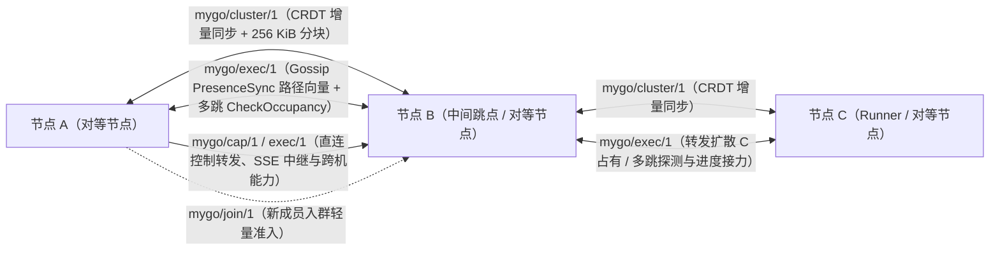

# 08 · 私有集群：无冲突同步与连通图 Gossip 协作

前面几篇把单台机器上的会话账本、记账员、JS 沙箱和前端界面都立起来了。可当你手里同时有办公室主机、云端服务器和随身携带的笔记本，想让它们既能各自独立工作，又能在连上网后合成同一套系统，立刻会撞上两个问题：

1. **断网各自改记录、聊对话时，怎么做到连上网不弹出“同步冲突”让我选边？**
2. **连着网时总不能两台机器同时替同一个会话烧双份模型钱，也不能这边正跑着另一边趁手删掉；可要是某台笔记本真的彻底断网成了孤岛，又怎么保证它随时想跑就能跑？**

MyGo-Bot 的答案是一脉相承的纯 AP（高可用 + 最终一致）本地优先设计：**所有节点完全对等，数据靠半格律 CRDT + DAG 永远自动合流；执行互斥像一张带敲门确认的合租白板，只在当前连通图内做路径向量 Gossip 扩散与多跳探测，彻底断网的孤岛直接本地放行。**

---

## 一、从 1 台单机长成多节点群：`mygo/join/1` 与成员发现

在 MyGo-Bot 里，**没有“主从/选民/边缘”身份区分，也没有“单机版”和“集群版”两套代码**。

首次开库建表时，程序会在 `local_node` 表里写入本机 Ed25519 身份（`node_id`）、32 字节集群密钥（`cluster_secret`）、持久化目录高水位 `catalog_rev = 0`、随机数据库纪元 `db_epoch` 与 `membership_gen = 1`。这时候你就是一台 **1 节点私有集群**。

- **按需延迟开网**：单机启动且未传 `--cluster-bind` 时，连 `iroh` QUIC 端点都通过 `OnceCell` 延迟到真正调用 `POST /cluster/invite` 或 `POST /cluster/join`（或库里已有 `cluster_peers`）才绑定 UDP 端口；日常写库先走 `known_peer_count() == 0` 原子快路径，不碰集群锁、不发唤醒信号，单机吞吐零损耗。
- **轻量准入入群（`JOIN_ALPN = b"mygo/join/1"`）**：
  1. 任意节点都能随时调 `POST /cluster/invite` 生成一次性邀请码（即便本机正跑着会话也允许）；
  2. 新节点带着邀请码调 `POST /cluster/join`（[src/cluster/mod.rs](../src/cluster/mod.rs) `Cluster::join_cluster`），经 `mygo/join/1` 向邀请方发双向 BLAKE3 keyed-MAC 鉴权请求；
  3. 邀请方在 `admit_joining_peer`（[src/cluster/net.rs](../src/cluster/net.rs)）确认集群密钥有效并把新同伴登记进 `cluster_peers` 后回传 `Admission { ok: true }`，接入方再把对方写入自己 `cluster_peers` 并按需切换 `membership_gen`。
- **退群/换群隔离、全网拨号与半连通现实**：
  - 已经入过群的节点如果粘贴不同群的邀请码，必须显式传 `force: true`（否则先返 `409 Conflict` 防误操作）；单独退出当前集群可调 `POST /cluster/leave`（[src/cluster/identity.rs](../src/cluster/identity.rs) `apply_leave`）。两者都会保留全部本机会话与目录数据，原地轮换 32 字节 `cluster_secret`、清空旧 `cluster_peers` / 游标 / `mcp_oauth.pending_refresh`、原子递增 `membership_gen` 并调 `net.switch_membership` 切断旧连接，靠 `assert_membership_gen` 把跨世代迟到同步包当场丢弃；
  - 任意两台节点握手连上后，`on_peer_connected` 立刻跑 **PEX（`ExchangePeers`）** 交换自己名片和最多 `64` 个已知成员（`MAX_PEX_PEERS`，群上限 `MAX_CLUSTER_PEERS = 256`；超过 `64` 个时经 `sample_peers_for_pex` 保留最近联系的 32 个并对其余同伴随机采样，避免固定按字典序截断长尾成员）。`addr_watch_loop` 会持续监听 `iroh` 的 `endpoint.watch_addr()`（2 秒防抖），网络地址变化后自动唤醒拨号并向在线同伴广播最新地址；只要通讯录里出现新节点或新地址，`upsert_peer_if_gen` 就会唤醒后台拨号器 `ClusterNet::dial_loop`（平时每 `15` 秒 `RECONNECT_INTERVAL` 也会巡检重拨，单次超时 `10` 秒 `DIAL_TIMEOUT`），并发直连所有未在线的已知同伴；双向同时拨通时，`register_peer_conn` 按 `node_id` 字典序确定性破冰，只留一条主连接；
  - 公网互通环境下，集群自然连成两两直连的**全互联（Full Mesh）**；但在 `--cluster-local` 跨双网卡跳板机、单边防火墙、链路局部抖动或刚入群拨号的短暂窗口期里，网络也会自然呈 **`A — B — C` 这类多跳连通图**。因此同步与执行互斥都从设计上兼容非全互联拓扑，绝不假设群内必须两两直连。
- **随时删除离线或在线同伴**：因为全群完全对等且无中心仲裁约束，调 `DELETE /cluster/peers/{node_id}` 可以直接删库清理对应同步游标与超时 OAuth 刷新委托、撤回该节点的占有视图并断开连接，哪怕对方长期关机也能瞬间清干净。

---

## 二、数据为什么永远不打架：半格律 CRDT 与双轨增量同步

很多分布式系统用一条前后紧扣的单链日志强求全网先后一致——两台机子断网各写一笔，链当场劈叉卡死，只能弹窗逼人选边覆盖。

MyGo-Bot 的同步模型建立在**半格律（Semilattice）CRDT** 上。本质就三条土办法：不管同步包**谁先到谁后到（交换律）**、**分五次到还是合一次到（结合律）**、**同一包收十遍（幂等律）**，任何两台机器合流完，最终结果一定一模一样。

具体分成两条各自独立的同步轨道（[src/cluster/ledger.rs](../src/cluster/ledger.rs)、[src/cluster/sync.rs](../src/cluster/sync.rs)）：

### 1. 轨道一：`CatalogSync`（全局目录 + `llm_calls` 账单）

- **固定宽度 HLC 逐字段取新（LWW）**：供应商、模型、共享 MCP 和会话封面字段都带混合逻辑时钟戳，格式统一为 `"{wall_ms:016x}:{logical:08x}:{node_id}"`（配 `MAX_HLC_WALL_MS = 1 << 60` 上界守卫与启动水印对齐 `seed_hlc_from_db`）。字符串字典序直接可比，同微秒撞车就按全局唯一的 `node_id` 决胜负。
- **语义绑定的字段必须一起比**：比如供应商把地址和密钥绑在同一枚 `endpoint_ts`（`lww_take_pair`），防“新钥匙寄给老地址”；共享 MCP 则以 `auth_config_ts` 为纪元锚点，配套 `headers_epoch_ts`/`headers_ts` 和 `oauth_epoch_ts`/`oauth_ts`（`EpochLwwAction`）与 `auth_fingerprint`（详见 [第 6 篇](06-mcp-and-oauth.md)），防换了服务端点还错发旧 OAuth 令牌。
- **两阶段有界差量拉取（`read_catalog_delta`）**：本地目录水位持久化在 `local_node.catalog_rev`（事务内经 `next_catalog_rev` 推进），并绑定开库生成的 `db_epoch`。发包前第一阶段只扫索引和字段字节估算，严格把每页钳在 **`DELTA_PAGE_LIMIT`（256 行）** 与 **`MAX_DELTA_BYTES`（1.5 MB）** 以内再读完整行；同时顺路按 `scope = "calls"` 的因果向量把 `llm_calls` 账单增量捎带上。

### 2. 轨道二：`SessionSync`（上下文 DAG 正文 + 超大分块）

- **五张因果表**：聊天正文与分支生命周期由 `items`、`context_nodes`、`turn_settled`、`invalidated_warnings` 和 **`pruned_context_nodes`**（冲突分支剪除墓碑）组成，每行带来源标签 `(origin_node_id, origin_seq)`，本机靠 `sync_vectors(scope = "session:<sid>")` 记住见过对方第几号。
- **按会话 Watch 懒同步**：新建或同步来的会话只在封面 `sessions` 里露面；只有当本机确认为未删会话并准备打开看、发消息、订阅 SSE 或开跑时，才经 `ensure_session_watched` 记入 `watched_sessions` 并持续追更（找不到或已删返 `404`）。
- **两阶段有界读取与 32 MiB 大消息接力（`read_session_delta`）**：正文不超过 **`MAX_INLINE_ITEM_PAYLOAD_BYTES`（1,000,000 字节）** 时直接内联发送；超长文本则只发摘要（长度 + BLAKE3 哈希），收方落库前专门用 `GetItemPayloadChunk` 按 **256 KiB** 分块补齐（上限 `MAX_ITEM_PAYLOAD_BYTES = 32 MiB`）并验哈希。
- **定点去重与乱序对齐（`apply_session_delta`）**：全量落库使用明确主键/唯一约束的 `ON CONFLICT(...) DO NOTHING`，绝不用笼统的 `INSERT OR IGNORE` 吞掉异常；收完包顺手刷新 `pending_inputs`、`session_leaves`（通过 `rebuild_session_leaves` 与 `ensure_active_head_not_pruned` 过滤已剪枝节点及后代）与 `active_context`。一旦发现分支切走或乱序补进了老消息（`out_of_order_view`），立刻推进视图版本号 `view_rev`（并由 `abort_active_session_worker` 拦停旧本地 Worker），保证前端绝不混页。

### 3. 全节点同步 vs 按需同步速查（[schema.sql](../schema.sql) 全部 21 张表）

为了既能随时随地翻目录、看总账，又不把百兆附件和私有脚本盲目灌满笔记本硬盘，全库 **21 张表**严格分为三档（外加 `model_catalog`、`pending` 两个只读视图）：

| 同步范围 | 涉及表名 | 具体同步规则 | 省掉会出什么问题 |
| :--- | :--- | :--- | :--- |
| **全节点同步** | `llm_providers`、`llm_models`、`sessions`（共享列）、`llm_calls`、`cluster_peers` | 目录字段按 HLC LWW、`llm_calls` 按因果向量随 `CatalogSync` 自动追更；群成员随 PEX 交换；删会话保留 `llm_calls`（`session_id` 置空） | 其他节点看不到模型列表、会话目录与全群真实花费统计 |
| **按需 / 部分同步** | `items`、`context_nodes`、`turn_settled`、`invalidated_warnings`、`pruned_context_nodes`、`attachments`、`mcp_servers`、`mcp_oauth` | • 会话正文与分支剪枝墓碑仅对记入 `watched_sessions` 的会话追更； • 附件仅同步元数据，原始字节（上限 50 MiB）在下载或跑模型前才按 **256 KiB 并发分块**从在线持有者拉取并算 BLAKE3 校验； • MCP 服务仅当 `shared = 1` 时连同已授权/已拒 `mcp_oauth` 同步，`shared = 0` 留在本地（仍可跨机远程调用） | 小容量设备被无关历史正文/视频撑爆，或本机 `stdio` 工具误传他机 |
| **死守本机** | `local_node`、`sessions.local_status` / `local_error`、`mcp_oauth.pending` / `pending_refresh`、`watched_sessions`、`peer_catalog_cursors`、`sync_vectors`、`item_attachments`、以及 3 张派生缓存表（`active_context`、`pending_inputs`、`session_leaves`） | 节点 Ed25519 私钥、运行中叠加态、登录中临时态、各节点同步游标与本地附件引用计数（支撑孤儿附件 GC）**永远不上网**；3 张派生表由本地事务实时重算 | 私钥泄漏、本机未收尾状态污染共享字段、同步进度错乱、误删本机附件 |

**工程防护边界**：
- **入站队列与反熵**：4 个固定入站工人配 `InboundState` 有界队列（`MAX_INBOUND_QUEUE = 4096`），由 `pop_inbound_work` 防止单个慢 peer 堵死他人，每 **30 秒**跑一次后台反熵；
- **并发与帧预算**：按 `peer` 和 `(sid, peer)` 加细粒度锁，`buffer_unordered(4)` 并发拉取；单条 RPC 封顶 2 MiB 请求头 / 12 MiB 响应头 / 2 MiB 体、全局 **32 MiB** 帧字节预算，超过 **64 KiB** 的 JSON 编解码自动卸去阻塞线程池；
- **尽力同步 vs 严格同步**：常规写入口与探测先走不阻塞失联节点的 **`sync_session_best_effort`**；一旦发现某在线邻居记录领先于本机，再调 **`sync_session_strict`** 把对方进度精确追齐。

### 4. 离线并发之后，怎么自然合拢？

- **同时改配置**：HLC 按字段取新，改标题和换模型并发各算各的，绝不互相擦除。
- **同一幂等键跨机撞车**：离线两台机器收到同一个 `Idempotency-Key` 产生了两条 `ItemId` 时，`reconcile_idempotency_key` 会自动把它们归入按字典序最小 `id` 领头的规范等价类——任意一条进上下文或被撤回，全组一起出列，绝不重跑两遍。
- **一方删、另一方还在改**：删除写成不可逆 `deleted = 1` 规范墓碑（清空正文与标题等可写列），离线同伴重连收到后照样墓碑化，绝不复活旧会话。
- **分区双边同时开跑与冲突分支收口**：
  - 集群断成两片并双边同时跑模型时，各自追加的 `context_nodes` 顺着共同祖先 `parent_id` 长成并存的 DAG 分支，合拢后统一收进 `session_leaves`（会话内分支**仅作冲突保险丝**，不能手动新增、共享同一个会话占用位）；
  - 若想清理非激活的冲突分支，可调 `DELETE /sessions/{sid}/branches/{head_id}`，通过 `prune_session_branch` 将该分支从分叉点往下的最高独占节点写进单调 CRDT 表 **`pruned_context_nodes`** 并全群同步（离线同伴在死枝上续写的节点到达后同样被剪除，若双边离线互相剪掉对方的激活分支，合流后通过 `ensure_active_head_not_pruned` 自动收敛回共同祖先，`has_inactive_branch` 同步过滤确保死枝消息永不回流到 `/history`）；
  - 若想保留两路并交由不同节点**同时并行跑**，无需切分支也无需暂停当前会话，直接调 `POST /sessions/{sid}/fork`（指定 `from_head` 冲突分支、`from_item` 历史消息或默认末端）瞬间克隆出一个完全独立的普通新会话即可（内容寻址附件零字节复制）。

---

## 三、连通图里的执行控制：白板传话、门口敲门与孤岛放行

私人集群只有一个主人——用户在多台设备之间调度任务时，最怕两件事：连着网时手抖在两台机子上同时点跑同一个会话（白烧两份模型钱），或者彻底断网时被“联系不上别人”挡在门外。

MyGo-Bot 的执行控制顺着纯 AP 哲学，像一套**“合租白板 + 进屋前贴 5 秒便签敲门 + 断网自己做主”**的机制（[src/cluster/exec.rs](../src/cluster/exec.rs)）。从底往上由三层拼成：

### 1. 本机账本：先认清自己正忙着什么（`SessionOccupancy` 与 `local_status`）

每台节点先管好本机这一亩三分地：
- **本地占有（`SessionOccupancy`）**：只要某个会话在本机跑着模型循环，或者还挂着没退完的后台 `codemode` 任务（含唤醒交接 `pending_wakes`），内存表 `PresenceState` 就会把这台会话记进本地占有列表；
- **私有叠加态（`sessions.local_status`）**：会话处于 `running` 或 `pausing` 期间，高频率的状态切换只写本机列 `local_status`、**永远不上网刷全群**；等回合真正停稳回 `idle` 或 `paused` 才写回共享列 `status` 并同步全群。**`local_status` 只管两件事**：避免半截运行状态污染其他机器，以及在进程意外崩溃重启时让 `Db::open` 精确挑出 `local_status IN ('running', 'pausing')` 收成 `paused`。省掉它，要么高频跑图把同期同步刷爆，要么进程挂掉时没法分清是本机卡死还是别人在跑。

### 2. 合租白板：路径向量 Gossip 传话（`PresenceSync`）

节点连通后，大家共享同一块“谁占着哪个会话”的内存白板（`PresenceState`），靠 `ExecReq::PresenceSync` 在三个时机互相传话：
1. **刚握上手互换底账（`peer_presence_sync_loop`）**：新邻居一连上，双方立刻交换全部占有声明，刚入网或刚重连的节点瞬间对齐视野；
2. **占有变化时即时扩散（`presence_broadcast_loop`）**：只要本机开跑、停稳，或学到了新的远端占有使 `gossip_seq` 递增，就往所有直连邻居推送最新快照（让网页与 `GET /sessions` 实时展示 `@runner`）；
3. **邻居掉线时立刻撤回（`clear_peer`）**：某邻居一断线，本机立刻抹掉经它学来的占有条目并再传播一次，防止僵尸占有把后续操作一直卡住。

> **为什么哪怕连成 `A — B — C` 或环网也不会转圈死循环？**
> 每条声明 `NodePresence { node_id, instance_id, seq, sessions, path }`（上限 `MAX_GOSSIP_HOPS = 6` 跳、表上限 `MAX_GOSSIP_ENTRIES = 257`、单节点最多 `MAX_PRESENCE_SESSIONS_PER_NODE = 256` 会话）都带着走过的路径 `path`。收方先整份替换 `remote_by_via[from_peer]`，拒绝 `path` 里含本机 `local_node_id` 或重复节点的包，并按 `(instance_id, seq)` 最大、路径最短选出汇总表 `effective`（没变化就不推 `gossip_seq`，零广播风暴）；往某直连邻居 `target` 打包时，**凡是 `node_id == target` 或 `path` 里已经出现 `target` 的条目一律剔除（水平分割 / Split Horizon）**——在 `A — B — C — A` 环网里，就算 `C` 突然从两边掉线，`A` 和 `B` 一轮交换即可彻底撤回，不会互相绕圈。

### 3. 门口敲门：点火开跑与删会话/删分支的实时门禁（`acquire_connected_gate`）

Gossip 白板本质是异步传话，路上总有几十毫秒延迟——如果两台机器恰好同一毫秒点开跑，光靠白板拦不住。所以真正调 `PUT /sessions/{sid}/run` 点火时，系统会在门口走一趟轻量实时敲门：

1. **单机或断网孤岛直接放行**：如果 `known_peer_count == 0` 且无在线邻居，零锁零 RPC 直接开跑；若已入群但此刻 `online_peer_ids()` 为空（完全孤岛），只在本地验完模型、分支历史完整与可用附件后直接放行。
2. **先查白板、贴 5 秒便签并尽力预拉**：有在线同伴时先查本地状态与白板——写着别人占着直接返 `409 Conflict`；白板上空闲，则在内存里立一块 **5 秒自清（`CLAIM_TTL`）的临时抢跑便签**（`LocalClaim` / `RunClaim`，不写盘、也不做任何心跳续租），随即调 `sync_session_best_effort` 从可达直连邻居预拉最近改动（超时的失联同伴直接跳过；**刻意延后分支完整性与缺失附件检查到探针与追平之后**，防 `CatalogSync` 领先于 `SessionSync` 或未经 watch 中间跳时本地提前误报 `409`）。
3. **带递减预算的最多 4 跳主动敲门（`CheckOccupancy` + `RelaySessionSync`）**：拿着 `{ claim, visited: [self], hops_left: 4, budget_ms }`（顶层总预算 `EXEC_PROBE_TIMEOUT = 3s`，每下转一跳扣除本跳耗时与 `EXEC_PROBE_HOP_MARGIN_MS = 350ms` 余量，不足 `EXEC_PROBE_MIN_BUDGET_MS = 400ms` 返 `504`）沿在线边群发给直连邻居；中间跳按需逐跳下传并向上合并下游节点的 `session_active_head_ts` 与 `session_vector`，统一汇聚四类答案：
   - **已删墓碑** → 通过独立长超时请求 **`ExecReq::RelaySessionSync`（`EXEC_OP_TIMEOUT = 30s`）** 沿连通分片拉回墓碑并返回 **`404`**；
   - **活跃占有 / 同毫秒抢跑** → 沿途任一节点本地跑着会话、挂着 `codemode` 任务或确认非发起方的占有，返回 **`409 Conflict`**；如果恰好两台机器同时贴出未提交的 `RunClaim`，按 `node_id` 字典序让小 ID 优先、大 ID 主动退让并退避抖动重试（最多试 `6` 次）；
   - **进度接力追平** → 若下游节点（比如 `A — B — C` 里的 `C`）的 `active_head_ts` 或 `session_vector` 比自己更新（`peer_ahead_of_local`），**发起端先发 `ExecReq::RelaySessionSync`（30 秒超时，不阻塞 3 秒探测信道）驱动中间跳 `B` 向 `C` 同步并回拉本地，再重试门禁**，确保哪怕隔着跳点换机开跑下一轮，也能接着 `C` 刚提交的最新回复往下聊；
   - **在线邻居超时闭环** → 若仍有直连邻居处于 `is_peer_online` 在线态却在探针中超时或返回下游 `504`，**绝不静默当成“未占用”放行**——先异步释放本轮便签（避免再等 3 秒同步释放累加延迟）并退避重试，耗尽仍超时则返回 **`503 Service Unavailable`**；只有真正已经掉线失联的邻居才按分区孤岛跳过。
4. **验分支补附件、正式落盘、上白板并撕掉便签**：确认没人抢也没人领先后，由 `validate_post_probe_run_ready` 校验本地 `session_branch_complete`；若存在缺失附件（`data IS NULL`），先主动释放 5 秒抢跑便签再拉完附件回来重试（防大文件下载撑爆 5 秒便签 TTL）；一切就绪后将便签升格为 `committing` 并落库点火 → 把包含本地占有的新 `NodePresence` 立刻广播上白板 → 发多跳 `ReleaseClaim` 清掉临时便签。**一旦正式开跑，运行途中绝不再发任何租约心跳；半路断网也不会杀掉正在跑的任务。**

**删除会话（`DELETE /sessions/{sid}`）与删除冲突分支（`DELETE /sessions/{sid}/branches/{head_id}`）复用同一套门禁的分叉（`acquire_delete_gate`）**：前半截同样是“孤岛直接放行、连网贴 5 秒便签做 4 跳 `CheckOccupancy` 排查（在线超时同样不误放行）”；分叉点在于删除不检查模型与附件、最多重试 `4` 次，只要连通图里确认没人跑着此会话也没挂着后台 `codemode` 任务（否则返 `409`），立刻写下会话 `deleted = 1` 墓碑或分支 `pruned_context_nodes` 剪枝墓碑。

---

## 四、跑起来之后：控制面转发与直连单跳边界

会话在某台 `Runner` 上跑起来之后，因为各节点靠 Gossip 实时掌握着白板上的 `runner_node_id`，网页端与 HTTP 控制面就能按“是否直连在线”清晰路由：

1. **指定执行节点**：调 `PUT /sessions/{sid}/run` 可传 `{ "node": "<id或节点名>" }`（WebUI 输入框右下角可直接选人），控制面经 `mygo/exec/1` 发 `StartRun` 给该直连在线节点点火（若目标当前离线直接返 `503`）。
2. **与 `Runner` 直连在线（单跳可达）**：
   - 发消息（会一并附带发送端登记的 `AttachmentRef` 元数据）、撤回消息、改标题、软硬暂停及查/杀 `codemode` 任务全部自动单跳转发给 `Runner` 处理；
   - 浏览器打开 `GET /sessions/{sid}/events` 时，接入端沿 `mygo/exec/1` 订阅 `SubscribeSessionEvents` 中继转发逐字打字机 SSE（最多 **64 路**并发，出口 `SeenSavedItems` 保留 256 条去重窗口防重放）。
3. **与 `Runner` 隔跳非直连（如 `A — B — C` 里在 `A` 操作跑在 `C` 的会话）**：
   - 写操作（发/撤消息、改配置、开跑、删会话）会看清白板上的 `C` 占有并安全返 **`409 Conflict`** 拒绝本地覆写；暂停与任务操作返 **`503 Service Unavailable`** 提示该执行节点与本机非直连；界面只靠本地 Gossip 同步的 `session.status` 更新追踪“运行中 / 已结束”，不做无意义的直连重试。
4. **跨节点原语沙箱**：至于脚本里 `cluster.node(target)` 如何走 `mygo/cap/1` 跨节点调文件、命令行、HTTP 和 MCP（同样要求目标直连在线，否则返 `ENODEUNREACH`），见 [第 4 篇](04-codemode-sandbox.md)。

---

**上一篇**：[07 · 实时流、HTTP API、内置文档与 WebUI](07-realtime-api-and-webui.md) · **返回目录**：[总览](README.md) · **下一篇**：[09 · 部署运维、压测验证、瘦身发布与评测体系](09-deployment-testing-and-tooling.md)
