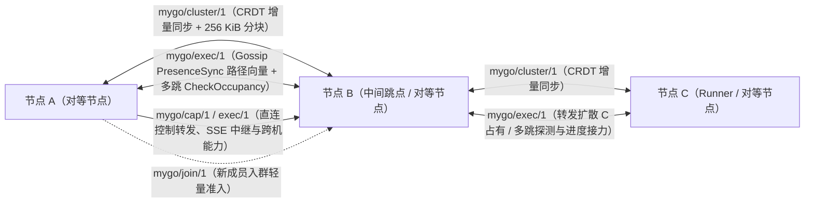

# 08 · 私有集群：无冲突同步与连通图 Gossip 协作

前面几篇把单台机器上的会话账本、记账员、JS 沙箱和前端界面都立起来了。可当你手里同时有办公室主机、云端服务器和随身携带的笔记本，想让它们既能各自独立工作，又能在连上网后合成同一套系统，立刻会撞上两个问题：

1. **断网各自改记录、聊对话时，怎么做到连上网不弹出“同步冲突”让我选边？**
2. **同一张连通网里总不能随便两台机器同时替同一个会话烧双份模型钱，也不能这边正跑着另一边趁手删掉会话；可要是某台机器真的完全离线成孤岛了，怎么保证它别被多数派锁死、照样随时能用？**

MyGo-Bot 的答案是一脉相承的纯 AP（高可用 + 最终一致）本地优先设计：**所有节点完全对等，数据靠半格律 CRDT + DAG 永远自动合流；执行互斥只向当前能连通的同伴做路径向量 Gossip 扩散与多跳探测，断网孤岛直接放行开跑。**

---

## 一、从 1 台单机长成多节点群：`mygo/join/1` 与成员发现

在 MyGo-Bot 里，**没有“主从/选民/边缘”身份区分，也没有“单机版”和“集群版”两套代码**。

首次开库建表（Schema `v1`）时，程序会在 `local_node` 表里写入本机 Ed25519 身份（`node_id`）、32 字节集群密钥（`cluster_secret`）、持久化目录高水位 `catalog_rev = 0`、随机数据库纪元 `db_epoch` 与 `membership_gen = 1`。这时候你就是一台 **1 节点私有集群**。

- **按需延迟开网**：单机启动且未传 `--cluster-bind` 时，连 `iroh` QUIC 端点都通过 `OnceCell` 延迟到真正调用 `POST /cluster/invite` 或 `POST /cluster/join`（或库里已有 `cluster_peers`）才绑定 UDP 端口；日常写库先走 `known_peer_count() == 0` 原子快路径，不碰集群锁、不发唤醒信号，单机吞吐零损耗。
- **轻量准入入群（`JOIN_ALPN = b"mygo/join/1"`）**：
  1. 任意节点都能随时调 `POST /cluster/invite` 生成一次性邀请码（即便本机正跑着会话也允许）；
  2. 新节点带着邀请码调 `POST /cluster/join`（[src/cluster/mod.rs](../src/cluster/mod.rs) `Cluster::join_cluster`），经 `mygo/join/1` 向邀请方发双向 BLAKE3 keyed-MAC 鉴权请求；
  3. 邀请方在 `admit_joining_peer`（[src/cluster/net.rs](../src/cluster/net.rs)）确认集群密钥有效并把新同伴登记进 `cluster_peers` 后回传 `Admission { ok: true }`，接入方再把对方写入自己 `cluster_peers` 并按需切换 `membership_gen`。
- **换群隔离、全网拨号与半连通现实**：
  - 已经入过群的节点如果粘贴不同群的邀请码，必须显式传 `force: true`（否则先返 `409 Conflict` 防误操作）。切换时保留本地数据、清空旧 `cluster_peers` 和游标、原子递增 `membership_gen`，并立即调 `net.switch_membership` 切断旧连接，靠 `assert_membership_gen` 把跨世代迟到同步包当场丢弃；
  - 任意两台节点握手通过后，靠 **PEX（`ExchangePeers`）** 自动交换全群成员清单与地址，`ClusterNet::dial_loop` 会主动拨号尝试与每位已知同伴建立直连（同毫秒互相拨通时按 `node_id` 字典序破冰，每同伴只保留一条主连接）；
  - 当公网开启中继/发现或局域网完全互通时，集群呈近似**全互联（Full Mesh）**；但在 `--cluster-local` 跨跳板网段、单向防火墙或链路局部抖动时，图会自然退化成 **`A — B — C` 这类非直连的多跳连通图**——这正是后面 Gossip 与多跳探测发挥威力的舞台。
- **随时离线删同伴**：因为没有 Voter 多数派束缚，调用 `DELETE /cluster/peers/{node_id}` 可以直接删库清理对应同步游标、撤回该节点的占有视图并断开连接，哪怕对方长期关机也能瞬间清干净。

---

## 二、数据为什么永远不打架：半格律 CRDT 与双轨增量同步

很多分布式系统用一条前后紧扣的单链日志强求全网先后一致——两台机子断网各写一笔，链当场劈叉卡死，只能弹窗逼人选边覆盖。

MyGo-Bot 的同步模型建立在**半格律（Semilattice）CRDT** 上。本质就三条土办法：不管同步包**谁先到谁后到（交换律）**、**分五次到还是合一次到（结合律）**、**同一包收十遍（幂等律）**，任何两台机器合流完，最终结果一定一模一样。

具体分成两条各自独立的同步轨道（[src/cluster/ledger.rs](../src/cluster/ledger.rs)、[src/cluster/sync.rs](../src/cluster/sync.rs)）：

### 1. 轨道一：`CatalogSync`（全局目录 + `llm_calls` 账单）

- **固定宽度 HLC 逐字段取新（LWW）**：供应商、模型、共享 MCP 和会话封面字段都带混合逻辑时钟戳，格式统一为 `"{wall_ms:016x}:{logical:08x}:{node_id}"`（配 `MAX_HLC_WALL_MS = 1 << 60` 上界守卫与启动水印对齐 `seed_hlc_from_db`）。字符串字典序直接可比，同微秒撞车就按全局唯一的 `node_id` 决胜负。
- **语义绑定的字段必须一起比**：比如供应商把地址和密钥绑在同一个 `endpoint_ts`（`lww_take_pair`），防“新钥匙寄给老地址”；共享 MCP 用四枚时间戳与 `auth_fingerprint`（`EpochLww`），防换了服务端点还错发旧 OAuth 令牌。
- **两阶段有界差量拉取（`read_catalog_delta`）**：本地目录版本号不再启动重算，而是持久化在 `local_node.catalog_rev`（事务内经 `next_catalog_rev` 推进），绑着开库生成的 `db_epoch`。发包前第一阶段只扫索引和字段字节估算，严格把每页钳在 **`DELTA_PAGE_LIMIT`（256 行）** 与 **`MAX_DELTA_BYTES`（1.5 MB）** 以内再读完整行；同时顺路按 `scope = "calls"` 的因果向量把 `llm_calls` 账单增量捎带上。

### 2. 轨道二：`SessionSync`（上下文 DAG 正文 + 超大分块）

- **四张因果表**：聊天正文由 `items`、`context_nodes`、`turn_settled` 和 `invalidated_warnings` 组成，每行带来源标签 `(origin_node_id, origin_seq)`，本机靠 `sync_vectors(scope = "session:<sid>")` 记住见过对方第几号。
- **按会话 Watch 懒同步**：新建或同步来的会话只在封面 `sessions` 里露面；只有当本机确认为未删会话并准备打开看、发消息、订阅 SSE 或开跑时，才经 `ensure_session_watched` 记入 `watched_sessions` 并持续追更（找不到或已删返 `404`）。
- **两阶段有界读取与 32 MiB 大消息接力（`read_session_delta`）**：正文不超过 **`MAX_INLINE_ITEM_PAYLOAD_BYTES`（1,000,000 字节）** 时直接内联发送；超长文本则只发摘要（长度 + BLAKE3 哈希），收方落库前专门用 `GetItemPayloadChunk` 按 **256 KiB** 分块补齐（上限 `MAX_ITEM_PAYLOAD_BYTES = 32 MiB`）并验哈希。
- **定点去重与乱序对齐（`apply_session_delta`）**：全量落库使用明确主键/唯一约束的 `ON CONFLICT(...) DO NOTHING`，绝不用笼统的 `INSERT OR IGNORE` 吞掉异常；收完包顺手刷新 `pending_inputs`、`session_leaves` 和 `active_context`。一旦发现分支切走或乱序补进了老消息（`out_of_order_view`），立刻推进视图版本号 `view_rev`（并由 `abort_active_session_worker` 拦停旧本地 Worker），保证前端绝不混页。

### 3. 全节点同步 vs 按需同步速查（[schema.sql](../schema.sql) 全部 19 张表）

为了既能随时随地翻目录、看总账，又不把百兆附件和私有脚本盲目灌满笔记本硬盘，全库 **19 张表**严格分为三档（外加 `model_catalog`、`pending` 两个只读视图）：

| 同步范围 | 涉及表名 | 具体同步规则 | 省掉会出什么问题 |
| :--- | :--- | :--- | :--- |
| **全节点同步** | `llm_providers`、`llm_models`、`sessions`（共享列）、`llm_calls`、`cluster_peers` | 目录字段按 HLC LWW、`llm_calls` 按因果向量随 `CatalogSync` 自动追更；群成员随 PEX 交换；删会话保留 `llm_calls`（`session_id` 置空） | 其他节点看不到模型列表、会话目录与全群真实花费统计 |
| **按需 / 部分同步** | `items`、`context_nodes`、`turn_settled`、`invalidated_warnings`、`attachments`、`mcp_servers`、`mcp_oauth` | • 会话正文仅对记入 `watched_sessions` 的会话追更； • 附件仅同步元数据，原始字节（上限 50 MiB）在下载或跑模型前才按 **256 KiB 并发分块**从在线持有者拉取并算 BLAKE3 校验； • MCP 服务仅当 `shared = 1` 时连同已授权/已拒 `mcp_oauth` 同步，`shared = 0` 留在本地（仍可跨机远程调用） | 小容量设备被无关历史正文/视频撑爆，或本机 `stdio` 工具误传他机 |
| **死守本机** | `local_node`、`sessions.local_status` / `local_error`、`mcp_oauth.pending` / `pending_refresh`、`watched_sessions`、`peer_catalog_cursors`、`sync_vectors`、以及 3 张派生缓存表（`active_context`、`pending_inputs`、`session_leaves`） | 节点 Ed25519 私钥、运行中叠加态、登录中临时态与各节点同步游标**永远不上网**；3 张派生表由本地事务实时重算 | 私钥泄漏、本机未收尾状态污染共享字段、同步进度互相错乱 |

> **工程防护边界**：后台同步由 4 个固定入站工人配 `InboundState` 有界队列（`MAX_INBOUND_QUEUE = 4096`，`pop_inbound_work` 防单个慢 peer 堵死他人），每 **30 秒**跑一次后台反熵；按 `peer` 和 `(sid, peer)` 加细粒度锁，`buffer_unordered(4)` 并发拉取；单条 RPC 封顶 2 MiB 请求头 / 12 MiB 响应头 / 2 MiB 体、全局 **32 MiB** 帧字节预算，超过 **64 KiB** 的 JSON 编解码自动卸去阻塞线程池。开跑或写入口先走尽最大努力不阻塞失联节点的 **`sync_session_best_effort`**；而一旦探测到某在线邻居记录领先于本机，则调 **`sync_session_strict`** 把那台落后进度精确追齐。

### 4. 离线并发之后，怎么自然合拢？

- **同时改配置**：HLC 按字段取新，改标题和换模型并发各算各的，绝不互相擦除。
- **同一幂等键跨机撞车**：离线两台机器收到同一个 `Idempotency-Key` 产生了两条 `ItemId` 时，`reconcile_idempotency_key` 会自动把它们归入按字典序最小 `id` 领头的规范等价类——任意一条进上下文或被撤回，全组一起出列，绝不重跑两遍。
- **一方删、另一方还在改**：删除写成不可逆 `deleted = 1` 规范墓碑（清空正文与标题等可写列），离线同伴重连收到后照样墓碑化，绝不复活旧会话。
- **分区双边同时开跑**：即便集群断成两片、用户在两边同一会话上分别点火跑了模型，各自追加的 `context_nodes` 也能顺着共同祖先 `parent_id` 长成两条并存的 DAG 分支，重连同步后全收进 `session_leaves`；默认按 `active_head_ts` 选出一个主视角，另一分支一字未丢，WebUI 顶栏 `Branch` 随时秒切回去接着聊。

---

## 三、连通图里的实时互斥：路径向量 Gossip 与多跳 `CheckOccupancy`

私人集群用户就是调度者自己，真遇到断网成孤岛的场景与其让 `503` 把用户拦在门外，不如像数据层一样坚持 **AP**：**连通网络之内尽量防呆拦截、孤岛之中放手自由运行**（[src/cluster/exec.rs](../src/cluster/exec.rs)）。

### 1. 平时主动扩散：路径向量 Gossip `PresenceSync`

为了在连网后（哪怕不是全互联，而是 `A — B — C` 这样的多跳链路）随时看清全连通分量里哪个节点占着哪条会话，节点之间通过 `ExecReq::PresenceSync` 交换 `NodePresence`：

- **只传源节点自己的全量声明（含 `path`）**：每个条目带源站 `(node_id, instance_id, seq, sessions)` 和一条经过路径 `path`（上限 `MAX_GOSSIP_HOPS = 6`、表上限 `MAX_GOSSIP_ENTRIES = 257`、每节点最多列 `MAX_PRESENCE_SESSIONS_PER_NODE = 256` 条）。
- **按来源分表 + 无环水平分割（Split Horizon）**：
  - 本地收到邻居发来的通告后先整体替换 `remote_by_via[from_peer]`，拒绝 `path` 里已经出现自己 `local_node_id` 或有重复节点的包，再按 `(instance_id, seq)` 最大、路径最短的规则确定性算出汇总表 `effective`；
  - 只有 `effective` 真正发生变化时才递增本机 `gossip_seq` 唤醒 `presence_broadcast_loop` 往下游邻居扩散（**同一条通告重复收到不会再回传，零广播风暴**）；
  - 向某个直连邻居 `target` 打包时，**凡是 `entry.node_id == target` 或 `entry.path` 里已经含着 `target` 的条目一律剔除（水平分割）**——比如环形网 `A — B — C — A` 里如果 `C` 同时从两边掉线，`A` 与 `B` 靠各自最后一次无 `C` 快照在一轮交换内就能同时把 `C` 撤回干净，彻底杜绝计数到无穷大。

### 2. 开跑/删会话前实时探路：`acquire_connected_gate`（多跳 `CheckOccupancy`）

Gossip 负责把占有状态平顺地推送给全连通图；而真正准备点火开跑或删除会话时，为了不撞上“另一台机器刚刚点下启动、Gossip 还在路上的那几十毫秒并发窗口”，`acquire_connected_gate` 会实时走一趟轻量多跳探测：

1. **单机 / 离线孤岛零阻拦**：若 `known_peer_count == 0` 且无在线邻居，零锁零 RPC 直接起跑；若已有同行节点但当前 `online_peer_ids()` 全空（完全孤岛），只在本地核对模型、分支完整性与可用附件后直接放行。
2. **拉齐直连进度并挂临时短声明（`RunClaim`）**：存在在线直连同伴时，先在内存里立一块 **5 秒自清（`CLAIM_TTL`）** 的临时声明 `LocalClaim`（仅用于并发抢跑决胜，不写盘、不需要任何心跳续租），调用 `sync_session_best_effort` 从可达邻居拉齐最新目录、正文与所需附件（任一邻居超时仅跳过，不再整群卡死返 `503`）。
3. **带去重与跳数上限的多跳 `CheckOccupancy`**：把 `{ claim, visited: [self], hops_left: 4 }` 群发给直连邻居；中间节点若自己未占着，就把自己的 `node_id` 压进 `visited`、跳数减一继续转发给其他未访问的在线邻居，并汇聚三类结果：
   - **已删墓碑**：沿途任一节点已标记 `deleted = 1` → 拉取墓碑并返回 **`404`**；
   - **活跃占有 / 并发抢占**：沿途任一节点本地跑着会话、挂着后台 `codemode` 任务、或感知到非发起方的远端/声明占有 → 返回 **`409 Conflict`**（若对方只是未提交的并发短声明，则按 `node_id` 字典序让小 ID 优先、大 ID 退避抖动重试最多 6 次）；
   - **进度接力追平**：下游节点的 `active_head_ts` 或 `session_vector` 比自己更新时，**中间跳点先向领先下游走一趟 `sync_session_strict`，回到起点时发起者再向直连邻居走 `sync_session_strict` 并重试**，保证即便在 `A — B — C` 链路上接力切换机器跑下一轮，也能带着刚刚 `C` 提交的最新回复开跑！
4. **点火通知并清理短声明**：确认无冲突且完成本地写库启动后，把包含本地活跃占有的新 `NodePresence` 立刻广播给直连邻居（进而 Gossip 到其余节点），同时发送带 `holder_node_id` 的多跳 `ReleaseClaim` 清掉 5 秒临时声明。

> **为什么还保留 `sessions.local_status`？**
> 哪怕已经彻底去掉失租熔断，`local_status` 依然不可缺少：只要会话还处于 `running` 或 `pausing`，状态变更只写本地列、不上网刷全群广播，等回合结算回到 `idle`/`paused` 再写回共享 `status` 同步全群；进程意外崩溃重启时，`Db::open` 也正靠 `local_status IN ('running', 'pausing')` 精确把本机残局收成 `paused`。

---

## 四、控制面与执行面分离：直连单跳转发与非直连边界

因为每台在线节点内存里都借 Gossip 实时掌握着全连通图的 `PresenceState`（哪个会话正由哪个 `runner_node_id` 占着），所以网页和 HTTP 控制口不区分主从节点，同时对直连与间接多跳保持清晰可预期的边界：

1. **指定执行节点**：调 `PUT /sessions/{sid}/run` 可传 `{ "node": "<id或节点名>" }`（WebUI 输入框右下角直接下拉选人），控制面经 `mygo/exec/1` 转发给该直连在线节点开跑（若目标当前离线返 `503`）。
2. **控制指令与状态查询**：
   - 当占有节点 `runner_node_id` 与接入端**直连在线**时，发消息（会打包发送端登记的 `AttachmentRef` 元数据）、撤回消息、改标题、软硬暂停及查/杀 `codemode` 任务全部自动单跳转发过去处理；
   - 当占有节点在 **`A — B — C` 两跳之外与当前节点非直连** 时，写操作会看到它的 Gossip 占有并安全返 `409 Conflict` 拒绝本地覆写，暂停/任务操作则返 `503` 明确提示该执行节点当前与本机非直连。
3. **实时打字机 SSE 跨机中继**：浏览器连向**直连非执行节点**的 `GET /sessions/{sid}/events` 时，接入端沿 `mygo/exec/1` 向 Runner 订阅 `SubscribeSessionEvents` 中继转发（上限 64 路并发，`SeenSavedItems` 容积 256 条去重）；如果占有者在非直连的多跳远端，接入端不陷入无意义直连重试，直接依靠本地 Gossip 同步的 `session.status` 更新与会话落盘通知驱动界面状态切换。
4. **跨节点原语沙箱**：至于脚本里 `cluster.node(target)` 如何走 `mygo/cap/1` 跨节点调文件、命令行、HTTP 和 MCP，见 [第 4 篇](04-codemode-sandbox.md)。

---

**上一篇**：[07 · 实时流、HTTP API、内置文档与 WebUI](07-realtime-api-and-webui.md) · **返回目录**：[总览](README.md) · **下一篇**：[09 · 部署运维、压测验证、瘦身发布与评测体系](09-deployment-testing-and-tooling.md)
