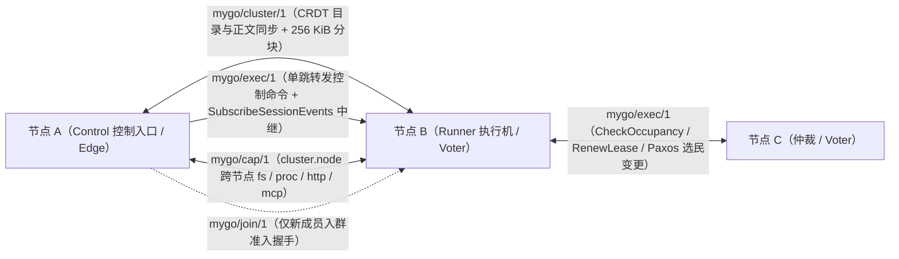

# 08 · 私有集群：无冲突同步与多数派执行控制

前面几篇把单台机器上的会话账本、记账员、JS 沙箱和前端界面都立起来了。可当你手里同时有办公室主机、云端服务器和随身携带的笔记本，想让它们既能各自独立工作，又能在连上网后合成同一套系统，立刻会撞上两个截然不同的难题：

1. **断网各自改记录、聊对话时，怎么做到连上网不弹出“同步冲突”让我选边？**
2. **数据允许离线多头写，但总不能两台机器同时替同一个会话调大模型（白烧双份钱），更不能这边正跑着、另一边趁断网把会话删了——这怎么防？**

MyGo-Bot 的答案特别干脆：**单机开机本来就是“1 节点集群”，平时零网络负担；组网后把难题一刀劈成“数据随便合（半格律 CRDT）”和“干活先抢牌（多数派租约）”两条互不拖累的轨道。**

---

## 一、从 1 台单机长成多节点群：`mygo/join/1` 与成员发现

在 MyGo-Bot 里，**没有“单机版”和“集群版”两套代码**。

首次开库建表（Schema `v1`）时，程序会在 `local_node` 表里写入本机 Ed25519 身份（`node_id`）、默认角色（`role = 'voter'`）、32 字节集群密钥（`cluster_secret`）、持久化目录高水位 `catalog_rev = 0`、随机数据库纪元 `db_epoch`，以及只有自己一人的选民配置 `voter_epoch = 1`。这时候你就是一台 **1 节点私有集群**。

- **按需延迟开网**：单机启动且未传 `--cluster-bind` 时，连 `iroh` QUIC 端点都通过 `OnceCell` 延迟到真正调用 `POST /cluster/invite` 或 `POST /cluster/join`（或库里已有 `cluster_peers`）才绑定 UDP 端口；日常写库先走 `known_peer_count() == 0` 原子快路径，不碰集群锁、不发唤醒信号，单机吞吐零损耗。
- **两步串行入群（`JOIN_ALPN = b"mygo/join/1"`）**：
  1. 在已有 `Voter` 的节点调 `POST /cluster/invite` 生成一次性邀请码（注意纯单机 `edge` 不允许邀请别人，会直接返 `409 Conflict`）；
  2. 新节点带着邀请码调 `POST /cluster/join`（[src/cluster/mod.rs](../src/cluster/mod.rs) `Cluster::join_cluster`），经 `mygo/join/1` 向邀请方发 `AuthMsg::Admission` 请求准入；
  3. 邀请方在 `admit_joining_peer`（[src/cluster/net.rs](../src/cluster/net.rs)）经双向 BLAKE3 keyed-MAC 验明身份后，在单个 SQLite 事务内核对当前 `voter_epoch > 0` 与非空 `voter_set`、写入 `cluster_peers`，再把最新 `(voter_epoch, voter_set)` 发回给加入方，避免“刚放行新节点自己又降成零 Voter”的竞态。
- **双端进群 409 守门（取代运行时半空热升级）**：
  - 早期设计试图允许单机一边跑会话一边并入集群并半路升级租约，结果把过渡状态捅进了写库通道与 JS I/O。现在规则干脆直接：**不管正在加入的一方，还是当前只有 0 同伴的单机邀请方，只要本地还挂着活跃会话、待唤醒队列或后台任务，调 `POST /cluster/join` / 准入事务就直接返回 `409 Conflict`**（提示先停稳再入群）；
  - 入群过程还挂着 RAII 锁 `PresenceState::begin_join`（`is_joining()`），在入群握手那几百毫秒内临时挡住新点火。
- **换群隔离与全网直连**：
  - 已经入过群的节点如果粘贴不同群的邀请码，必须显式传 `force: true`（否则先返 `409 Conflict` 防误操作）。切换时保留本地数据、清空旧 `cluster_peers` 和游标、原子递增 `membership_gen`，并立即调 `net.switch_membership` 切断旧连接，靠 `assert_membership_gen` 把跨世代迟到同步包当场丢弃；
  - 任意两台节点握手通过后，靠 **PEX（`ExchangePeers`）** 自动发现全网其余同伴，同步各自的 `role`、`meta_seq` 与地址；同毫秒互相拨通时按 `node_id` 字典序破冰，只保留较小一方主动拨出的那条连接（每同伴同一时刻只留一个 `DialGuard`）。

---

## 二、数据为什么永远不打架：半格律 CRDT 与双轨增量同步

很多分布式系统用一条前后紧扣的单链日志强求全网先后一致——两台机子断网各写一笔，链当场劈叉卡死，只能弹窗逼人选边覆盖。

MyGo-Bot 的同步模型建立在**半格律（Semilattice）CRDT** 上。听起来学术，本质就三条土办法：不管同步包**谁先到谁后到（交换律）**、**分五次到还是合一次到（结合律）**、**同一包收十遍（幂等律）**，任何两台机器合流完，最终结果一定一模一样。

具体分成两条各自独立的同步轨道（[src/cluster/ledger.rs](../src/cluster/ledger.rs)、[src/cluster/sync.rs](../src/cluster/sync.rs)）：

### 1. 轨道一：`CatalogSync`（全局目录 + `llm_calls` 账单）

- **固定宽度 HLC 逐字段取新（LWW）**：供应商、模型、共享 MCP 和会话封面字段都带混合逻辑时钟戳，格式统一为 `"{wall_ms:016x}:{logical:08x}:{node_id}"`（配 `MAX_HLC_WALL_MS = 1 << 60` 上界守卫与启动水印对齐 `seed_hlc_from_db`）。字符串字典序直接可比，同微秒撞车就按全局唯一的 `node_id` 决胜负。
- **语义绑定的字段必须一起比**：比如供应商把地址和密钥绑在同一个 `endpoint_ts`（`lww_take_pair`），防“新钥匙寄给老地址”；共享 MCP 用四枚时间戳与 `auth_fingerprint`（`EpochLww`），防换了服务端点还错发旧 OAuth 令牌。
- **两阶段有界差量拉取（`read_catalog_delta`）**：本地目录版本号不再启动重算，而是持久化在 `local_node.catalog_rev`（事务内经 `next_catalog_rev` 推进），绑着开库生成的 `db_epoch`。发包前第一阶段只扫索引和字段字节估算，严格把每页钳在 **`DELTA_PAGE_LIMIT`（256 行）** 与 **`MAX_DELTA_BYTES`（1.5 MB）** 以内再读完整行；同时顺路按 `scope = "calls"` 的因果向量把 `llm_calls` 账单增量捎带上。

### 2. 轨道二：`SessionSync`（上下文 DAG 正文 + 超大分块）

- **四张因果表**：聊天正文由 `items`、`context_nodes`、`turn_settled` 和 `invalidated_warnings` 组成，每行带来源标签 `(origin_node_id, origin_seq)`，本机靠 `sync_vectors(scope = "session:<sid>")` 记住见过对方第几号。
- **按会话 Watch 懒同步**：新建或同步来的会话只在封面 `sessions` 里露面；只有当本机确认为未删会话并准备打开看、发消息、订阅 SSE 或开跑时，才经 `ensure_session_watched` 记入 `watched_sessions` 并持续追更（找不到或已删返 `404`）。
- **两阶段有界读取与 32 MiB 大消息接力（`read_session_delta`）**：正文不超过 **`MAX_INLINE_ITEM_PAYLOAD_BYTES`（1,000,000 字节）** 时直接内联发送；超长文本则只发摘要（长度 + BLAKE3 哈希），收方落库前专门用 `GetItemPayloadChunk` 按 **256 KiB** 分块补齐（上限 `MAX_ITEM_PAYLOAD_BYTES = 32 MiB`）并验哈希。
- **定点去重与乱序对齐（`apply_session_delta`）**：全量落库使用明确主键/唯一约束的 `ON CONFLICT(...) DO NOTHING`，绝不用笼统的 `INSERT OR IGNORE` 吞掉异常；收完包顺手刷新 `pending_inputs`、`session_leaves` 和 `active_context`。一旦发现分支切走或乱序补进了老消息（`out_of_order_view`），立刻推进视图版本号 `view_rev`（并由 `abort_active_session_worker` 拦停旧本地 Worker），保证前端绝不混页。

### 3. 全节点同步 vs 按需同步速查（[schema.sql](../schema.sql) 全部 20 张表）

为了既能随时随地翻目录、看总账，又不把百兆附件和私有脚本盲目灌满笔记本硬盘，全库 20 张表严格分为三档（外加 `model_catalog`、`pending` 两个只读视图）：

| 同步范围 | 涉及表名 | 具体同步规则 | 省掉会出什么问题 |
| :--- | :--- | :--- | :--- |
| **全节点同步** | `llm_providers`、`llm_models`、`sessions`（共享列）、`llm_calls`、`cluster_peers` | 目录字段按 HLC LWW、`llm_calls` 按因果向量随 `CatalogSync` 自动追更；群成员随 PEX / Paxos 一致；删会话保留 `llm_calls`（`session_id` 置空） | 其他节点看不到模型列表、会话目录与全群真实花费统计 |
| **按需 / 部分同步** | `items`、`context_nodes`、`turn_settled`、`invalidated_warnings`、`attachments`、`mcp_servers`、`mcp_oauth` | • 会话正文仅对记入 `watched_sessions` 的会话追更； • 附件仅同步元数据，原始字节（上限 50 MiB）在下载或跑模型前才按 **256 KiB 并发分块**从在线持有者拉取并算 BLAKE3 校验； • MCP 服务仅当 `shared = 1` 时连同已授权/已拒 `mcp_oauth` 同步，`shared = 0` 留在本地（仍可跨机远程调用） | 小容量设备被无关历史正文/视频撑爆，或本机 `stdio` 工具误传他机 |
| **死守本机** | `local_node`、`sessions.local_status` / `local_error`、`mcp_oauth.pending` / `pending_refresh`、`watched_sessions`、`peer_catalog_cursors`、`sync_vectors`、`session_leases`、以及 3 张派生缓存表（`active_context`、`pending_inputs`、`session_leaves`） | 节点 Ed25519 私钥、运行中叠加态、登录中临时态、各节点同步游标与本地租约记录**永远不上网**；3 张派生表由本地事务实时重算 | 私钥泄漏、本机断网熔断污染共享状态、同步进度互相错乱 |

> **工程防护边界**：后台同步由 4 个固定入站工人配 `InboundState` 有界队列（`MAX_INBOUND_QUEUE = 4096`，`pop_inbound_work` 防单个慢 peer 堵死他人），每 **30 秒**跑一次后台反熵；按 `peer` 和 `(sid, peer)` 加细粒度锁，`buffer_unordered(4)` 并发拉取；单条 RPC 封顶 2 MiB 请求头 / 12 MiB 响应头 / 2 MiB 体、全局 **32 MiB** 帧字节预算，超过 **64 KiB** 的 JSON 编解码自动卸去阻塞线程池。开跑或删会话前必须走 **`sync_session_strict`**，任一同伴失联或翻满 1024 页未追平直接报错（`503` / `504`），绝不拿着半截账干活。

### 4. 离线并发之后，怎么自然合拢？

- **同时改配置**：HLC 按字段取新，改标题和换模型并发各算各的，绝不互相擦除。
- **同一幂等键跨机撞车**：离线两台机器收到同一个 `Idempotency-Key` 产生了两条 `ItemId` 时，`reconcile_idempotency_key` 会自动把它们归入按字典序最小 `id` 领头的规范等价类——任意一条进上下文或被撤回，全组一起出列，绝不重跑两遍。
- **一方删、另一方还在改**：删除写成不可逆 `deleted = 1` 规范墓碑（清空正文与标题等可写列），离线同伴重连收到后照样墓碑化，绝不复活旧会话。
- **同时强制离线开跑**：各自追加的 `context_nodes` 顺着共同祖先 `parent_id` 长成两条并存的 DAG 分支，全收进 `session_leaves`；默认按 `active_head_ts` 选出一个主视角，另一分支一字未丢，WebUI 顶栏 `Branch` 随时秒切回去接着聊。

---

## 三、怎么防止两台机器撞车：选民多数派租约与 `Voter` / `Edge`

聊天记录允许离线分叉，但**同一个会话不能让两台机器同时烧钱跑模型，也不能在失联时偷偷删掉别人正在聊的会话**。

这就轮到执行面（[src/cluster/exec.rs](../src/cluster/exec.rs)）出场——它干的事情说白了就一句话：**谁要跑或要删这个会话，先向多数派领一块“全群唯一且有时限的工作牌”。**

### 1. 多数派（Quorum）、10 秒租约与 1 秒安全余量

假设群里有 3 台机器 A、B、C：
- **为什么必须过半数（多数派）？** 如果 A 断网收不到 B、C 回音就“默认没人管、我先跑”，另一边 B 和 C 也跑了就立刻撞车。要求至少超过半数节点（3 里至少 2 票）点头发牌，世界同一时刻就绝对不会出现两拨多数派。
- **为什么牌子只有 10 秒，自己却按 9 秒停表？** 拿牌的机器如果突然拔电源，牌子必须会自动失效，否则会话永久锁死：
  - 每次发出的 `Quorum` 租约有效期是 **`LEASE_TTL`（10 秒）**；
  - 持有者在后台每隔 **`LEASE_RENEW_INTERVAL`（3 秒）** 群发一次 `RenewLease` 续租；
  - 本地闹钟故意砍掉 **`LEASE_SAFETY_MARGIN`（1 秒）**，第 **9 秒**续不上就自己停手。**如果省掉这 1 秒余量**，旧机器可能在 9.9 秒自以为还活着写入最后一步，而新机器在 10.0 秒刚好领走新牌，造成双写撞车。
- **递增任期 `term`**：每次抢牌 `term` 递增（并持久化进同伴 `session_leases`）。断网恢复后拿着老任期发来的迟到续约包，同伴直接拿高 `term` 拒掉。

### 2. 抢牌四步流与“开跑 / 删会话”同门禁（`acquire_session_lease`）

每次点“运行”或“删除会话”（群内存在同伴时），都在同一条 `acquire_session_lease` 状态机里按序过四道关：

1. **占草稿位（`LocalClaim`）**：把 `term` 加一，本地先立临时工牌（同毫秒多机撞车按 `node_id` 字典序错峰退让，高 `term` 自动压倒旧任期）。
2. **先对齐账与附件**：调 `sync_session_strict` 把对话追到最新并核对分支完整与附件齐全（删除流程复用同一状态机，只跳过分支完整性与可用模型检查）。
3. **全员点名过进度栅栏（`CheckOccupancy`）**：向**所有在线同伴（包括 `Voter` 和 `Edge`，不漏掉边缘机器上的活跃任务）**问四件事——删没删、谁占着、进度到哪、给不给我投第 `term` 任一票：
   - 任一同伴记过墓碑 → 同步并返回 **`404`**；
   - 任一同伴正运行或挂着后台 JS 任务 → 返回 **`409 Conflict`**；
   - 任一同伴的 `active_head_ts` 或因果向量领先本机 → **说明本机拿的是旧视角，撤回草稿牌，先跑强同步追齐再重抢**（这就是进度栅栏，省掉就会拿着旧账抢跑或误删）；
   - 遇更高 `voter_epoch` 先采纳，再重走本轮。
4. **凑够 `voter_quorum` 正式落牌**：票数过半后把本地 `LocalClaim` 升为 `Committing`、`RunAuth::Quorum` 正式点火（或作为 `DeleteGateGuard` 隔离牌带进最后的 SQLite 删除事务里再次验活，防预约过期）。

### 3. `Voter` 与 `Edge` 角色：别让笔记本拖垮服务器

如果把笔记本和云服务器全算进投票数，笔记本一合盖出门，2 台里需要 2 票，云服务器自己直接卡死。因此节点分两类角色（启动可选 `--cluster-role`，组群后在 WebUI / `PATCH /cluster/self` 在线修改）：

- **`voter`（常驻仲裁者）**：计入多数派分母与门槛（`total_voters / 2 + 1`）。
- **`edge`（边缘节点，如笔记本）**：**不算进多数派门槛**，随时合盖断网也不影响集群照常开工；联着网时**照样参与占有点名、照样能直接运行会话、照样能被其他节点调用本地能力**。

> **选民数量小贴士**：因为过半门槛是 `total_voters / 2 + 1`，**恰好 2 台 `voter` 时门槛也是 2 票**（任何一台重启都会短暂失多数派）。常见“2 台机器 + 1 台笔记本”更推荐 **1 核心 `voter` + 2 `edge`** 或 **3 `voter` + 1 `edge`**。

为了防止脑裂，群内选民名单带着单调版本号 **`voter_epoch`**，任何人也不能单机偷偷改名单：
- **强保底至少 1 个 `Voter`**：在多节点群里，任何试图把最后一个 `Voter` 降级成 `Edge`（`change_self_role`）或踢出群（`remove_peer_safe`）的操作都会被当场返回 **`409 Conflict`**；就算出现异常空名单，`voter_quorum` 也会直接返回不满足，绝不放行。
- **单裁决 Paxos 联合多数派变更**：所有加/减选民（改自己角色、删同伴、新 `voter` 由 `try_auto_admit_voter` 自动补录）统一抽象成 `VoterDelta::{Add, Remove}` 收口到 `propose_voter_config_locked`——走标准的 **`ProbeVoterEpoch` -> `PrepareVoterConfig` -> `CommitVoterConfig`**（刻意不设能擦除已承诺选票的 Abort RPC）。只有**旧选民集 `C_old` 和新选民集 `C_new` 两边同时过半**，才能推进 `voter_epoch`，提交瞬间立刻对本机持有旧纪元租约的会话做仅本机熔断停机（`fence_stale_local_leases`）。

### 4. 三条最容易看晕的保护边界

1. **双轨状态拆表（`status` vs `local_status`）**：共享 `status` 只有拿着有效租约正常停稳才写；本机跑着（`running`）、软停中（`pausing`）或断网第 9 秒失租自锁熔断（`fence_session_local` / `fence_local_run`）只准写本地列 **`local_status` / `local_error`**（永远不上网）。省掉这一层拆分，断网节点死前记的那笔“暂停”就会在重连后把外面已经继续跑完的最新共享结果覆盖脏掉。
2. **写库两态极简校验**：去掉运行期“半空退回等待升级”的中间过渡态后，[src/store.rs](../src/store.rs) 记账员批提交 `commit_batch` 时对执行写入只查三样：`is_joining()` 不在入群中途、`run_gen` 没被新 Worker 顶掉、`is_local_lease_valid` 为真（过界立即返 `409`）。
3. **显式离线强跑（`force_offline: true`）与重连优雅交接**：默认失多数派会返 `503` 拦住；若传了 `force_offline: true`，本地会挂无租约 `ForcedOffline` 标记继续跑（靠 DAG 分叉保证不丢记录）。等网络恢复并凑齐 `Voter` 多数派时，后台 **`reconcile_offline_sessions`** 不会粗暴腰斩它，而是发一次**仅本机的软暂停**（写 `local_status = 'pausing'`），等当前这一步 `step` 体面跑完落库并同步给同伴，再清掉离线后台任务、摘掉 `ForcedOffline` 停进本地 `paused`（若本来只剩离线挂着的后台任务则直接本地熔断），随后重开即可领正式 `Quorum` 租约续跑。

---

## 四、控制面与执行面分离：连着谁都能管全群

因为每台在线节点内存里都实时同步着 `PresenceState`（哪个会话眼下挂着哪个 `runner_node_id`，就算只是 `idle` 但还留着后台 `codemode` 任务也算占用中），所以网页和 HTTP 入口完全不需要找“主节点”：

1. **指定执行节点**：调 `PUT /sessions/{sid}/run` 可传 `{ "node": "<id或节点名>" }`（WebUI 输入框右下角直接下拉选人），控制面自动经 `mygo/exec/1` 单跳转发给目标节点抢牌并起跑。
2. **控制指令自动路由**：无论连上哪台节点发起发消息（会打包发送端登记的 `AttachmentRef` 元数据，免去附件还未同步过来时误报 `400`）、撤回消息、改标题、软硬暂停还是查/杀 `codemode` 任务，只要会话正由远端 Runner 占着，一律自动单跳转发过去处理。
3. **实时打字机 SSE 跨机中继**：浏览器连向**非执行节点**的 `GET /sessions/{sid}/events` 时，接入端直接沿 `mygo/exec/1` 向 Runner 订阅 `SubscribeSessionEvents` 中继转发（甚至单机未组群前提前打开的 SSE 连接，也能在入群那一刻静默接进集群中继，且上限 64 路并发）；出口处用容积 **256 条**的 **`SeenSavedItems`** 去重窗口防中继与同步双推，断线自动带当前 `view` 补推 `resync`。
4. **跨节点原语沙箱**：至于脚本里 `cluster.node(target)` 如何走 `mygo/cap/1` 跨节点调文件、命令行、HTTP 和 MCP，见 [第 4 篇](04-codemode-sandbox.md)。

---

**上一篇**：[07 · 实时流、HTTP API、内置文档与 WebUI](07-realtime-api-and-webui.md) · **返回目录**：[总览](README.md) · **下一篇**：[09 · 部署运维、压测验证、瘦身发布与评测体系](09-deployment-testing-and-tooling.md)
