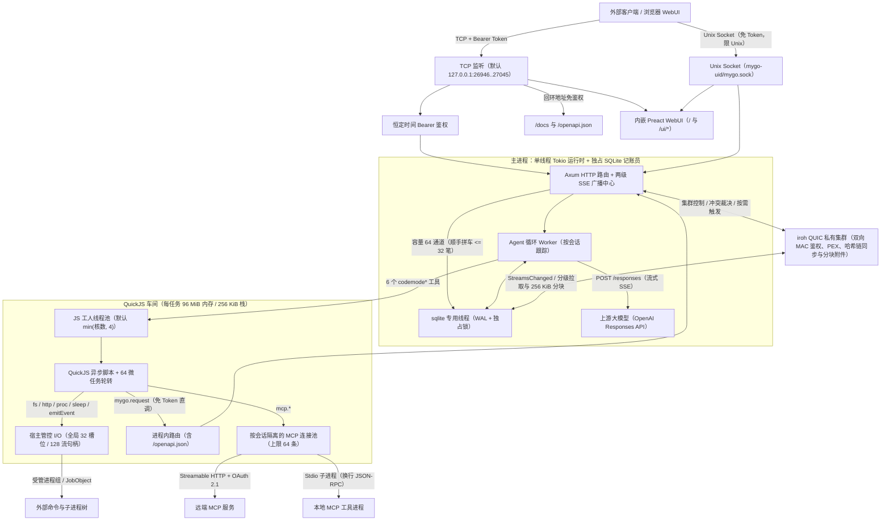

# How MyGo-Bot Works

MyGo-Bot 是一个用 Rust（`1.100.0`，edition 2024）编写的极简常驻 Agent 运行框架。它平时作为一个单进程守护服务跑在机器上（单机即天然构成 1 节点私有集群，也可通过 `iroh` QUIC 组网并用 BLAKE3 `(epoch, seq)` 哈希链自动在多节点间同步数据与分块附件），对外提供 HTTP 和 SSE 接口（内置一套轻量 WebUI 和 OpenAPI 文档），对上通过 OpenAI Responses API 驱动大模型，对内用 SQLite 死守每笔对话流水账，对下只给模型极少数几个正交原语，让模型自己写 JavaScript 代码去组合文件、网络、命令行、MCP 外部工具甚至操控 MyGo 自己。

把整套代码剥到骨子里，它只靠三根柱子撑住全部复杂度：

1. **可停可续的两本账循环**：流水账 `items` 只增不删，喂给模型的上下文 `context_items` 另外按顺序排齐，中间靠两个书签（`input_queue_cursor` 和 `needs_model`）管住“门外新信取到哪”和“还欠不欠模型看一眼”。这套结构把软暂停、硬暂停、自动重试、优雅退出和断电崩溃恢复全统一起来了。
2. **一条网络线配一个独占记账员（内置集群同步底座）**：整个进程只有一条单线程 Tokio 异步运行时接网、收流，配一条专属 `sqlite` 线程拿独占锁握着 `mygo.sqlite3`。记账员绝不跨网络 I/O 干活，靠“顺手拼车”把多笔写入并成一次刷盘，靠“先钉页尾、再小块接力”和“两级广播槽”让几十个会话、一堆围观窗口同时跑也不堵门；每次提交在事务落盘后按 `(epoch, seq)` BLAKE3 哈希链通知 `iroh` QUIC 私有集群按需同步。
3. **最小完备原语的 `codemode` 沙箱**：模型手里没有五花八门的工具，只有 `codemode`、原地等信的 `codemode_wait` 和四个任务遥控器。所有干活的积木——读写普通文件、发 HTTP、拉起带进程组笼子的子进程、发现和调用远端或本地 MCP 工具、以及用 `mygo.request` 自我内省——全放在独立的 QuickJS 工人线程里按需组合。

---

## 全局架构一览

---

## 阅读路线（从底往上，建议通读顺序）

| 篇目 | 文档 | 它解决什么问题 | 核心机制与涉及模块 |
| :--- | :--- | :--- | :--- |
| 第 1 篇 | [核心抽象与 Agent 循环](01-agent-loop.md) | 对话怎么存、怎么推着走、怎么安全停和崩后收残局 | `items` 与 `context_items` 两本账、投信与点火分离、`step`、`steer`、双书签、`pending` 视图、软/硬暂停、重试、优雅退出、崩溃恢复 |
| 第 2 篇 | [底层底座：单记账员、合批落盘、流式读写与防重](02-storage-and-concurrency.md) | 只有一个记账员，为什么多人并发投信、翻账、删会话不堵不乱；多节点间怎么安全同步 | 单线程运行时 + 独占 `sqlite` 线程、容量 64 通道、32 笔顺手拼车与 `savepoint`、钉页尾分块接力读、`Idempotency-Key`、`call_id` 唯一索引、单机即 1 节点集群、`iroh` P2P 组网、`(epoch, seq)` 哈希链分级同步与双向冲突裁决 |
| 第 3 篇 | [模型目录、多模态附件与精确计费](03-catalog-media-and-billing.md) | 怎么管多家模型、按需同步大文件媒体、不差一厘钱地算账 | 供应商/模型目录与软归档、四道校验铁门、会话显式选模、50 MiB 内容寻址与按需 256 KiB 多节点分块附件拉取及实时展开、`llm_calls`、`PriceBook` 快照与 `cost_nano_usd` 零浮点结算 |
| 第 4 篇 | [Codemode 上篇：最小完备原语、独立车间与宿主能力](04-codemode-sandbox.md) | 怎么让模型写 JS 安全干重活，既不冻住主线程也不留孤儿进程 | JS 工人池与 QuickJS 隔离、`TextDecoder`/`TextEncoder`、流句柄与背压、`fs` 防设备文件、`http`、`proc.exec` 进程笼、`mygo.*` 自省、输出合流与 `savepoint` 落盘 |
| 第 5 篇 | [Codemode 下篇：前后台分流、原地等信、实时透视与租期恢复](05-codemode-lifecycle.md) | 脚本跑久了怎么办、没跑完怎么不轮询等信、怎么查进度和防死循环 | 90 秒后台欠条、`codemode_event` 与 `wake`、门外双信箱分叉、`codemode_wait` 唤醒弦与 `trigger_code` 探针、`LiveState` 指纹去重、2 小时租期与 `invalidated_warnings`、3 秒等遗言 |
| 第 6 篇 | [外部工具扩展：MCP 协议、双传输与 OAuth 2.1](06-mcp-and-oauth.md) | 脚本怎么连外部工具，怎么防泄密、防 SSRF、并发和跨节点刷新不丢令牌 | 按会话懒连接池、Streamable HTTP 两阶段协商、Stdio 两槽预占、`BinaryData` 打包、错误脱敏与未知结果语义、诊断体检、OAuth 2.1 全链路、单服务 `shared` 集群同步开关与 OAuth 跨节点刷新协调 |
| 第 7 篇 | [实时流、HTTP API、内置文档与 WebUI](07-realtime-api-and-webui.md) | 打字机实时流怎么不错不漏、前端怎么同步状态、接口怎么暴露 | 两级 SSE（持久 64 + 临时 256）与跨通道定序、36 路径 / 51 操作接口全景、三条路由面分流、Scalar 文档、gzip 内嵌 WebUI（含 Cluster 页签与冲突徽章）及防复活/防缺口状态机 |
| 第 8 篇 | [部署运维、压测验证、瘦身发布与评测体系](08-deployment-testing-and-tooling.md) | 怎么打包上线、注册系统服务、跑压测和真刀真枪做对比评测 | 启动握手管道、Token 落盘保密、Unix Socket、`install` 与 `launchd`/`systemd`、版本与 UPX/DMG 瘦身、26 场景压测核账、Harbor 59 题评测 |

---

## 全书核心术语速查

| 术语 | 一句话大白话 | 首次详讲 |
| :--- | :--- | :--- |
| **`item` 与流水账** | 每发生一件对话事件（发信、撤回、回答、调工具、交结果）在 `items` 表记的一笔不可删改的明细 | [第 1 篇](01-agent-loop.md) |
| **上下文** | `context_items` 表里按 `position` 排好顺序、真正端给模型看的那份整理后材料 | [第 1 篇](01-agent-loop.md) |
| **`step` 与 `steer`** | 一次模型请求连同它派出去的那批工具收尾归档算一 `step`；中途用户插话不打断本步、下步自动收进上下文叫 `steer` | [第 1 篇](01-agent-loop.md) |
| **`input_queue_cursor` / `needs_model`** | 前者记门外排队输入取到哪一笔，后者记上下文还欠不欠模型看一眼 | [第 1 篇](01-agent-loop.md) |
| **软暂停 / 硬暂停** | 软暂停让本 `step` 收完尾再停；硬暂停当场掐断，认 `item` 边界保存，未果工具补“结果未知” | [第 1 篇](01-agent-loop.md) |
| **顺手拼车与 `savepoint`** | 记账员把通道口排队的最多 32 笔兼容写单拢进一次刷盘，每人套独立反悔点互不连坐 | [第 2 篇](02-storage-and-concurrency.md) |
| **哈希链与 `epoch`** | 每条可同步资源自带一条按 `(epoch, seq)` 编号、用 BLAKE3 环环相扣的提交链；分叉裁决选择本地强推时把 `epoch` 加 1 写全量快照，让离线落后节点重连后直接收敛 | [第 2 篇](02-storage-and-concurrency.md) |
| **Watch 懒同步与永久墓碑** | 会话目录默认全集群同步，明细正文（`items`/`context_items`）默认不拉取，直到某节点真正打开或操作才进入 Watch 持续追更；删除写下永久墓碑，防离线节点重连时把删掉的资源重新复活 | [第 2 篇](02-storage-and-concurrency.md) |
| **价格快照与 `cost_nano_usd`** | 开跑时把当前生效的时段阶梯价冻在 `llm_calls` 里，收尾用纯整数按十亿分之一美元精确结算 | [第 3 篇](03-catalog-media-and-billing.md) |
| **受管命令（进程笼）** | `proc.exec` 和 MCP `stdio` 把子进程关进 Unix 进程组或 Windows `JobObject`，退出/超时时连根清场 | [第 4 篇](04-codemode-sandbox.md) |
| **后台欠条与 `codemode_event`** | 超过 90 秒或显式后台运行的脚本先交回带 `codemode_call_item_id` 戳的收据，后续消息/提醒/完工信另起事件进队 | [第 5 篇](05-codemode-lifecycle.md) |
| **唤醒弦与 `trigger_code`** | `codemode_wait` 在内存里挂根递增序号等门外动静；可选配一次性无副作用探针脚本和它赛跑 | [第 5 篇](05-codemode-lifecycle.md) |
| **`LiveState` 与 `invalidated_warnings`** | 内存中实时抄送 `console`、子进程管道尾部和 MCP 阶段；作废表负责屏蔽门外已过时的续租提醒 | [第 5 篇](05-codemode-lifecycle.md) |
| **世代号（`generation`）** | 每次 MCP OAuth 登录发一块唯一新牌子，防迟到回调或刷新任务把已注销的登录复活 | [第 6 篇](06-mcp-and-oauth.md) |
| **两级流与 `gapOpen`** | 服务端用“持久 64 + 草稿 256”两路带全局序号的 SSE 推屏幕；前端重连时锁住游标补齐缺口再放行 | [第 7 篇](07-realtime-api-and-webui.md) |

---

**下一篇**：[01 · 核心抽象与 Agent 循环](01-agent-loop.md)
