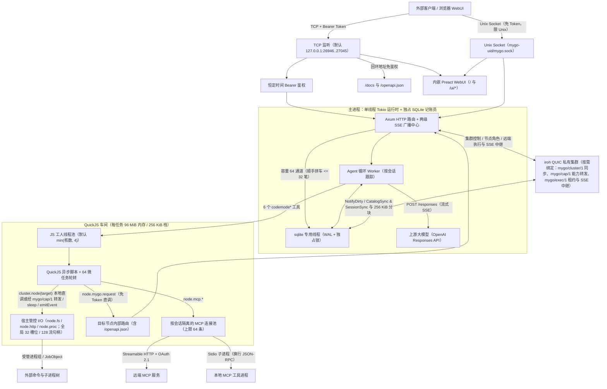

# How MyGo-Bot Works

MyGo-Bot 是一个用 Rust（`1.100.0`，edition 2024）编写的极简常驻 Agent 运行框架。它平时作为一个单进程守护服务跑在机器上（单机即天然构成 1 节点私有集群且按需绑定 QUIC，组网后可通过 `iroh` QUIC 基于半格律 CRDT 与上下文 DAG 自动无冲突同步数据与分块附件，并由 `blake3` 负责双向鉴权与附件完整性校验，支持跨节点能力调度与控制面/执行面分离），对外提供 HTTP 和 SSE 接口（内置一套轻量 WebUI 和 OpenAPI 文档），对上通过 OpenAI Responses API 驱动大模型，对内用 SQLite 死守每笔对话流水账，对下只给模型极少数几个正交原语，让模型自己写 JavaScript 代码去组合文件、网络、命令行、MCP 外部工具甚至操控任意节点上的 MyGo 实例。

把整套代码剥到骨子里，它只靠三根柱子撑住全部复杂度：

1. **可停可续、可分叉的 DAG 两本账循环**：流水账 `items` 只增不删，真正按顺序排齐的历史写成带父指针的只增上下文 DAG `context_nodes` 并按当前分支头 `active_head`（仅允许切换到完整叶节点）物化投影进 `active_context`，中间靠物化门外信箱 `pending_inputs` 和只增回合结账集 `turn_settled`（从中直接推导出 `needs_model`）管住“门外还有哪些待收新信”和“当前分支末端还欠不欠模型看一眼”；数据库把全集群同步的持久状态 `status`（`idle`/`paused`）与只留本机的运行叠加态 `local_status` 彻底拆开，崩溃恢复更按 `llm_calls.input_head` 精确认领属于当前分支的在途调用，把软暂停、硬暂停、自动重试、优雅退出、分支切换以及离线并发分叉后的无损并存统一起来了。
2. **一条网络线配一个独占记账员（内置集群与执行底座）**：整个进程只有一条单线程 Tokio 异步运行时接网、收流，配一条专属 `sqlite` 线程拿独占锁握着 `mygo.sqlite3`。记账员绝不跨网络 I/O 干活，靠“顺手拼车”把多笔写入并成一次刷盘，靠“不可变主键快照分段吐出 + `X-History-View` 视图令牌”和“两级广播槽”让几十个会话、一堆围观窗口同时翻页和切换分支也不堵不串页；纯单机默认按需延迟绑定 QUIC 端点，组网后在事务落盘后汇总脏标记通知 `iroh` QUIC 私有集群按半格律增量同步（目录按 HLC LWW、`llm_calls` 与会话正文按因果向量、超大单条 `ItemWire` 走 `GetItemPayloadChunk` 256 KiB 分块接力），并以带 `voter_epoch` 两阶段联合多数派成员变更的 `Voter`/`Edge` 投票多数派执行租约护航控制面与执行面分离。
3. **最小完备原语的云化 `codemode` 沙箱**：模型手里没有五花八门的工具，只有 `codemode`、原地等信的 `codemode_wait` 和四个任务遥控器。所有干活的积木——读写普通文件、发 HTTP、拉起带进程组笼子的子进程、发现和调用远端或本地 MCP 工具、以及用 `node.mygo.request` 自我内省——全收敛到 `cluster.nodes()` 与 `cluster.node(target)` 提供的对等节点句柄中，放在独立的 QuickJS 工人线程里按需跨节点组合。

---

## 全局架构一览

---

## 阅读路线（从底往上，建议通读顺序）

| 篇目 | 文档 | 它解决什么问题 | 核心机制与涉及模块 |
| :--- | :--- | :--- | :--- |
| 第 1 篇 | [核心抽象与 Agent 循环](01-agent-loop.md) | 对话怎么存、怎么推着走、怎么安全停和崩后收残局 | `items`、`context_nodes` DAG 与 `active_context` 投影、投信与点火分离、`step`、`steer`、`pending_inputs` 与 `turn_settled`、`Voter`/`Edge` 多数派执行租约与 `voter_epoch` 两阶段联合多数派成员变更、`GateMode`/`RunAuth` 门控与断联复核、`status`/`local_status` 持久化与本机叠加态分离、叶节点分支切换、软/硬暂停、重试、优雅退出、按 `input_head` 分支归属的崩溃恢复 |
| 第 2 篇 | [底层底座：单记账员、合批落盘、流式读写与防重](02-storage-and-concurrency.md) | 只有一个记账员，为什么多人并发投信、翻账、删会话不堵不乱；多节点间怎么无冲突同步 | 单线程运行时 + 独占 `sqlite` 线程、容量 64 通道、32 笔顺手拼车与 `savepoint`、不可变主键快照分页 + `X-History-View` 视图连续性、`Idempotency-Key` 跨节点规范等价类收敛、`call_id` 与 `v10` 去跨表外键/去全局唯一约束的应用层防重、单机按需绑定 `iroh` QUIC、HLC 逐字段 LWW + 持久化 `local_node.catalog_rev` 水位、两阶段有界差量读取与超大 `ItemWire` 256 KiB 分块同步、按 Peer 细粒度并发锁、`ON CONFLICT` 精准去重、单调墓碑与无冲突合流 |
| 第 3 篇 | [模型目录、多模态附件与精确计费](03-catalog-media-and-billing.md) | 怎么管多家模型、按需同步大文件媒体、不差一厘钱地算账 | 供应商/模型目录与软归档、供应商 `endpoint_ts` 原子合并、四道校验铁门、会话显式选模、50 MiB 内容寻址与全链路有界流式附件（上传配额、256 KiB 多节点分块拉取、`blob_open` 实时 Base64 展开与 `pinned_head` 分支校验）、`active_context` 增量历史校验前缀缓存、`llm_calls`（含 `input_head` 钉分支）、`PriceBook` 快照与 `cost_nano_usd` 零浮点结算 |
| 第 4 篇 | [Codemode 上篇：最小完备原语、独立车间与宿主能力](04-codemode-sandbox.md) | 怎么让模型写 JS 安全干重活，既不冻住主线程也不留孤儿进程 | JS 工人池与 QuickJS 隔离、`cluster.node(target)` 云化节点句柄、`TextDecoder`/`TextEncoder`、跨节点流句柄与背压、`fs` 防设备文件、`http`、`proc.exec` 进程笼、`node.mygo.request` 内网接口、输出合流与 `savepoint` 落盘 |
| 第 5 篇 | [Codemode 下篇：前后台分流、原地等信、实时透视与租期恢复](05-codemode-lifecycle.md) | 脚本跑久了怎么办、没跑完怎么不轮询等信、怎么查进度和防死循环 | 90 秒后台欠条、`codemode_event` 与 `wake`、门外双信箱分叉、`codemode_wait` 唤醒弦与 `trigger_code` 探针、`LiveState` 指纹去重、2 小时租期与 `invalidated_warnings`、3 秒等遗言 |
| 第 6 篇 | [外部工具扩展：MCP 协议、双传输与 OAuth 2.1](06-mcp-and-oauth.md) | 脚本怎么连外部工具，怎么防泄密、防 SSRF、并发和跨节点刷新不丢令牌 | 按会话懒连接池、Streamable HTTP 两阶段协商、Stdio 两槽预占、`BinaryData` 打包、错误脱敏与未知结果语义、诊断体检、OAuth 2.1 全链路、四时间戳（`config_ts`/`auth_config_ts`/`oauth_epoch_ts`/`oauth_ts`）与 `auth_fingerprint` 端点防串用、纯刷新不驱逐连接池、单服务 `shared` 集群同步开关与 OAuth 跨节点刷新协调 |
| 第 7 篇 | [实时流、HTTP API、内置文档与 WebUI](07-realtime-api-and-webui.md) | 打字机实时流怎么不错不漏、前端怎么同步状态、接口怎么暴露 | 两级 SSE（持久 64 + 临时 256）与跨通道定序、34 路径 / 49 操作接口全景、三条路由面分流、Scalar 文档、gzip 内嵌 WebUI（含顶栏 DAG 分支切换与 Cluster 节点角色切换）、`X-History-View` / `?view=` 防分支混页校验及防复活/防缺口状态机 |
| 第 8 篇 | [部署运维、压测验证、瘦身发布与评测体系](08-deployment-testing-and-tooling.md) | 怎么打包上线、注册系统服务、跑压测和真刀真枪做对比评测 | 启动握手管道、Token 落盘保密、Unix Socket、`install` 与 `launchd`/`systemd`、版本与 UPX/DMG 瘦身、26 场景压测核账、Harbor 59 题评测 |

---

## 全书核心术语速查

| 术语 | 一句话大白话 | 首次详讲 |
| :--- | :--- | :--- |
| **`item` 与流水账** | 每发生一件对话事件（发信、撤回、回答、调工具、交结果）在 `items` 表记的一笔不可删改的明细 | [第 1 篇](01-agent-loop.md) |
| **上下文 DAG 与 `active_context`** | 排好序的历史写成 `context_nodes` 只增父链节点，并沿当前 `active_head` 物化投影到 `active_context` 表，真正端给模型看的那份材料 | [第 1 篇](01-agent-loop.md) |
| **`step` 与 `steer`** | 一次模型请求连同它派出去的那批工具收尾归档算一 `step`；中途用户插话不打断本步、下步自动收进上下文叫 `steer` | [第 1 篇](01-agent-loop.md) |
| **`pending_inputs` 与 `turn_settled`** | 前者是精确追踪门外有效待收输入的本地物化表；后者是只增的回合结账集合，只要当前 `active_head` 不在里面就自动推导出 `needs_model = true` | [第 1 篇](01-agent-loop.md) |
| **软暂停 / 硬暂停** | 软暂停让本 `step` 收完尾再停；硬暂停当场掐断，认 `item` 边界保存，未果工具补“结果未知” | [第 1 篇](01-agent-loop.md) |
| **顺手拼车与 `savepoint`** | 记账员把通道口排队的最多 32 笔兼容写单拢进一次刷盘，每人套独立反悔点互不连坐 | [第 2 篇](02-storage-and-concurrency.md) |
| **半格律合并（HLC LWW + 因果向量）** | 所有跨节点同步合并满足交换律、结合律与幂等律——目录按字段级 HLC 时间戳 `*_ts` 取新并借持久化 `local_node.catalog_rev`（表行 `sync_rev`）游标增量拉取，会话正文与调用账单按 `(origin_node_id, origin_seq)` 因果向量差量补齐，彻底消灭同步冲突与人工裁决 | [第 2 篇](02-storage-and-concurrency.md) |
| **Watch 懒同步与单调墓碑** | 会话目录默认全集群同步，明细正文（`items`、`context_nodes`、`turn_settled`、`invalidated_warnings`）仅对记进 `watched_sessions` 的会话持续追更；删除写下只增不减的 `0 -> 1` `deleted` 墓碑，防离线节点重连时把删掉的资源重新复活 | [第 2 篇](02-storage-and-concurrency.md) |
| **控制面 / 执行面** | 集群里任意节点都可作为入口接 HTTP 控制与中继 SSE（控制面），真正跑大模型与后台脚本的节点通过 `mygo/exec/1` 独立承接（执行面） | [第 1 篇](01-agent-loop.md) |
| **多数派执行租约（`Voter` / `Edge`）** | 全集群区分投票节点 `Voter` 与边缘节点 `Edge`：由 `voter_epoch` 两阶段联合多数派（新旧选民双多数）护航成员变更，开跑前与删会话时通过 `Occupancy` 进度栅栏先向全体在线同伴探占有并按需强同步最新进度，10 秒租约（每 3 秒续租）只数当前选民集 `Voter` 多数派，失多数派 9 秒内本地熔断仅记本机 `local_status` 停机 | [第 1 篇](01-agent-loop.md) |
| **价格快照与 `cost_nano_usd`** | 开跑时把当前生效的时段阶梯价冻在 `llm_calls` 里，收尾用纯整数按十亿分之一美元精确结算 | [第 3 篇](03-catalog-media-and-billing.md) |
| **受管命令（进程笼）** | `proc.exec` 和 MCP `stdio` 把子进程关进 Unix 进程组或 Windows `JobObject`，退出/超时时连根清场 | [第 4 篇](04-codemode-sandbox.md) |
| **后台欠条与 `codemode_event`** | 超过 90 秒或显式后台运行的脚本先交回带 `codemode_call_item_id` 戳的收据，后续消息/提醒/完工信另起事件进队 | [第 5 篇](05-codemode-lifecycle.md) |
| **唤醒弦与 `trigger_code`** | `codemode_wait` 在内存里挂根递增序号等门外动静；可选配一次性无副作用探针脚本和它赛跑 | [第 5 篇](05-codemode-lifecycle.md) |
| **`LiveState` 与 `invalidated_warnings`** | 内存中实时抄送 `console`、子进程管道尾部和 MCP 阶段；作废表负责屏蔽门外已过时的续租提醒 | [第 5 篇](05-codemode-lifecycle.md) |
| **世代号（`generation`）** | 每次 MCP OAuth 登录发一块唯一新牌子，配合端点指纹 `auth_fingerprint` 防迟到回调或刷新任务把已注销或换了地址的登录复活 | [第 6 篇](06-mcp-and-oauth.md) |
| **两级流、`gapOpen` 与 `X-History-View`** | 服务端用“持久 64 + 草稿 256”两路带全局序号的 SSE 推屏幕；`X-History-View`（`<instance_id>:<view_rev>`）与 `?view=` 校验历史视图连续性，前端重连锁住游标补齐缺口，分支切换或乱序合流撞上不一致直接重拉 | [第 7 篇](07-realtime-api-and-webui.md) |

---

**下一篇**：[01 · 核心抽象与 Agent 循环](01-agent-loop.md)
