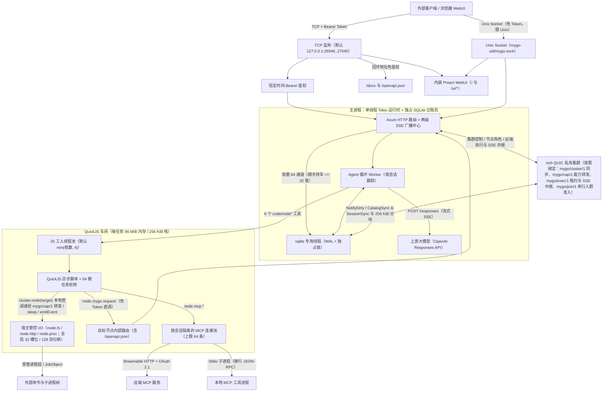

# How MyGo-Bot Works

MyGo-Bot 是一个用 Rust（`1.100.0`，edition 2024）编写的极简常驻 Agent 运行框架。单机开机即自成 1 节点私有集群（按需绑定 `iroh` QUIC），连上同伴后基于半格律 CRDT 与上下文 DAG 无冲突同步数据，并支持跨节点能力调度与控制/执行面分离。

剥到骨子里，整套架构只靠三根柱子撑住全部复杂度：

1. **可停可续、可分叉的 DAG 两本账循环**：流水账 `items` 只增不删，排好序的历史写成上下文 DAG `context_nodes` 并按当前分支头 `active_head` 投影到 `active_context`；配合门外信箱 `pending_inputs`、只增结账集 `turn_settled`（推导出 `needs_model`），以及分享稳态 `status` 与本机叠加态 `local_status` 的拆分，把软硬暂停、重试、退出与分支切换统一起来。
2. **单网络线配独占记账员 + 私人集群**：整个进程一条单线程 Tokio 事件循环接网，一条独占 `sqlite` 线程握着 `mygo.sqlite3`，绝不跨网络 I/O 持锁，靠“顺手拼车”与“不可变快照切片”扛住高并发；组网后拆成互不打架的 CRDT 数据同步与 `Voter`/`Edge` 多数派执行租约两套协议。
3. **最小完备原语的云化 `codemode` 沙箱**：模型手头只有 `codemode`、原地等信的 `codemode_wait` 和任务遥控器；所有对文件、命令、HTTP、MCP 和节点自身 API 的操作全部收进 `cluster.node(target)`，跑在受监管的 QuickJS 工人线程池里并按需经 `mygo/cap/1` 跨节点执行。

---

## 全局架构一览

---

## 阅读路线（从底往上，共 9 篇）

| 篇目 | 文档 | 它解决什么问题 | 核心机制与涉及模块 |
| :--- | :--- | :--- | :--- |
| 第 1 篇 | [核心抽象与 Agent 循环](01-agent-loop.md) | 对话怎么存、怎么推着走、怎么安全停和崩后收残局 | `items`、`context_nodes` DAG 与 `active_context` 投影、投信与点火分离、`step`、`steer`、`pending_inputs` 与 `turn_settled`、双轨状态拆分、叶节点分支切换、软/硬暂停、重试、优雅退出、按 `input_head` 归属恢复 |
| 第 2 篇 | [底层底座：单记账员、合批落盘、流式读写与防重](02-storage-and-concurrency.md) | 只有一个记账员，为什么多人并发投信、翻账、删会话不堵不乱 | 单线程运行时 + 独占 `sqlite` 线程、容量 64 通道、32 笔顺手拼车与 `savepoint`、两态写租约核验、`JsonRows` 不可变快照分页 + `X-History-View`、`Idempotency-Key` 规范等价类、`v1` 无跨表外键防重、规范墓碑删会话 |
| 第 3 篇 | [模型目录、多模态附件与精确计费](03-catalog-media-and-billing.md) | 怎么管多家模型、按需同步大文件媒体、不差一厘钱地算账 | 供应商/模型目录与软归档、原子 `endpoint_ts`、四道校验铁门、显式选模、50 MiB 有界流式附件（上传配额、256 KiB 分块拉取、`blob_open` 实时 Base64 展开）、`llm_calls` 与 `cost_nano_usd` 结算 |
| 第 4 篇 | [Codemode 上篇：最小完备原语、独立车间与宿主能力](04-codemode-sandbox.md) | 怎么让模型写 JS 安全干重活，既不冻住主线程也不留孤儿进程 | JS 工人池与 QuickJS 隔离、`cluster.node(target)` 云化句柄、`TextDecoder`/`TextEncoder`、跨节点流句柄与背压、`fs`/`http`/`proc.exec` 进程笼、`node.mygo.request`、`savepoint` 出力 |
| 第 5 篇 | [Codemode 下篇：前后台分流、原地等信、实时透视与租期恢复](05-codemode-lifecycle.md) | 脚本跑久了怎么办、没跑完怎么不轮询等信、怎么查进度和防死循环 | 90 秒后台欠条、`codemode_event` 与 `wake`、门外双信箱分叉、`codemode_wait` 唤醒弦与 `trigger_code` 探针、`LiveState` 指纹去重、2 小时租期与 `invalidated_warnings`、3 秒等遗言 |
| 第 6 篇 | [外部工具扩展：MCP 协议、双传输与 OAuth 2.1](06-mcp-and-oauth.md) | 脚本怎么连外部工具，怎么防泄密、防 SSRF、并发和跨节点刷新不丢令牌 | 按会话懒连接池、Streamable HTTP 两阶段握手、Stdio 两槽预占、`BinaryData` 打包、错误脱敏与未知结果语义、诊断体检、OAuth 2.1 全链路、`EpochLww` 四时间戳、`shared` 开关与跨节点刷新协调 |
| 第 7 篇 | [实时流、HTTP API、内置文档与 WebUI](07-realtime-api-and-webui.md) | 打字机实时流怎么不错不漏、前端怎么同步状态、接口怎么暴露 | 两级 SSE（持久 64 + 临时 256）与 `NEXT_SEQ` 定序、`ALPN mygo/exec/1` 跨节点中继、34 路径 / 49 操作接口全景、三条路由面、Scalar 文档、gzip 内嵌 Preact WebUI、`knownView` 防混页状态机 |
| 第 8 篇 | [私有集群：无冲突同步与多数派执行控制](08-cluster-sync-and-execution.md) | 多台设备组群后，数据怎么自动合流不打架，开跑与删会话怎么防撞车 | 单机按需绑定 QUIC、`mygo/join/1` 准入与双向进群 `409` 守门、PEX 与确定性破冰、半格律 CRDT（HLC LWW + 因果向量 + `local_node.catalog_rev` + 256 KiB 分块）、四档同步范围、`Voter`/`Edge` 多数派租约与进度栅栏、Paxos 选民变更、`force_offline` 重连软暂停、控制/执行面分离 |
| 第 9 篇 | [部署运维、压测验证、瘦身发布与评测体系](09-deployment-testing-and-tooling.md) | 怎么打包上线、注册系统服务、跑压测和真刀真枪做对比评测 | 启动握手管道、Token 保密、Unix Socket、`install` 与 `launchd`/`systemd`、版本与 UPX/DMG 瘦身、26 场景压测核账、Harbor 59 题评测 |

---

## 全书核心术语速查

| 术语 | 一句话大白话 | 首次详讲 |
| :--- | :--- | :--- |
| **`item` 与流水账** | 每发生一件对话事件（发信、撤回、回答、调工具、交结果）在 `items` 表记的一笔不可删改的明细 | [第 1 篇](01-agent-loop.md) |
| **上下文 DAG 与 `active_context`** | 排好序的历史写成 `context_nodes` 只增父链节点，并沿当前 `active_head` 物化投影到 `active_context` 表，真正端给模型看的那份材料 | [第 1 篇](01-agent-loop.md) |
| **`step` 与 `steer`** | 一次模型请求连同它派出去的那批工具收尾归档算一 `step`；中途用户插话不打断本步、下步自动收进上下文叫 `steer` | [第 1 篇](01-agent-loop.md) |
| **`pending_inputs` 与 `turn_settled`** | 前者是精确追踪门外有效待收输入的本地物化表；后者是只增的回合结账集合，只要当前 `active_head` 不在里面就自动推导出 `needs_model = true` | [第 1 篇](01-agent-loop.md) |
| **软暂停 / 硬暂停** | 软暂停让本 `step` 收完尾再停；硬暂停当场掐断，认 `item` 边界保存，未果工具补“结果未知” | [第 1 篇](01-agent-loop.md) |
| **顺手拼车与 `savepoint`** | 记账员把通道口排队的最多 32 笔兼容写单拢进一次刷盘，每人套独立反悔点互不连坐 | [第 2 篇](02-storage-and-concurrency.md) |
| **半格律合并（HLC LWW + 因果向量）** | 所有跨节点同步合并满足交换律、结合律与幂等律——目录按 HLC 时间戳 `*_ts` 取新并借持久化 `catalog_rev` 游标增量拉取，正文与账单按 `(origin_node_id, origin_seq)` 因果向量补齐 | [第 8 篇](08-cluster-sync-and-execution.md) |
| **Watch 懒同步与单调墓碑** | 会话列表全群同步，正文仅对记进 `watched_sessions` 的会话持续追更；删除写下只增不减的 `0 -> 1` `deleted` 墓碑防复活 | [第 8 篇](08-cluster-sync-and-execution.md) |
| **控制面 / 执行面** | 集群里任意节点都可接 HTTP 控制与中继 SSE（控制面），真正跑大模型与后台脚本的节点通过 `mygo/exec/1` 独立承接（执行面） | [第 8 篇](08-cluster-sync-and-execution.md) |
| **多数派执行租约（`Voter` / `Edge`）** | 全群区分常驻选民 `Voter` 与边缘节点 `Edge`：Paxos 联合多数派护航选民变更；开跑和删会话共用进度栅栏与 10 秒多数派租约（每 3 秒续租，9 秒失租仅写 `local_status` 熔断） | [第 8 篇](08-cluster-sync-and-execution.md) |
| **价格快照与 `cost_nano_usd`** | 开跑时把当前生效的时段阶梯价冻在 `llm_calls` 里，收尾用纯整数按十亿分之一美元精确结算 | [第 3 篇](03-catalog-media-and-billing.md) |
| **受管命令（进程笼）** | `proc.exec` 和 MCP `stdio` 把子进程关进 Unix 进程组或 Windows `JobObject`，退出/超时时连根清场 | [第 4 篇](04-codemode-sandbox.md) |
| **后台欠条与 `codemode_event`** | 超过 90 秒或显式后台运行的脚本先交回带 `codemode_call_item_id` 戳的收据，后续消息/提醒/完工信另起事件进队 | [第 5 篇](05-codemode-lifecycle.md) |
| **唤醒弦与 `trigger_code`** | `codemode_wait` 在内存里挂根递增序号等门外动静；可选配一次性无副作用探针脚本和它赛跑 | [第 5 篇](05-codemode-lifecycle.md) |
| **`LiveState` 与 `invalidated_warnings`** | 内存中实时抄送 `console`、子进程管道尾部和 MCP 阶段；作废表负责屏蔽门外已过时的续租提醒 | [第 5 篇](05-codemode-lifecycle.md) |
| **世代号（`generation`）** | 每次 MCP OAuth 登录发一块唯一新牌子，配合端点指纹 `auth_fingerprint` 防迟到回调或刷新任务把已注销或换了地址的登录复活 | [第 6 篇](06-mcp-and-oauth.md) |
| **两级流、`gapOpen` 与 `X-History-View`** | 服务端用“持久 64 + 草稿 256”两路带 `NEXT_SEQ` 全局序号的 SSE 推屏幕；`X-History-View` 校验历史视图连续性，前端重连锁游标补缺口，切分支直接重拉 | [第 7 篇](07-realtime-api-and-webui.md) |
